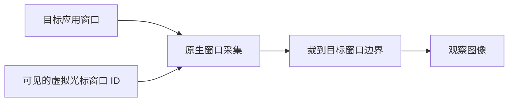

# Codex 原生光标与桌面驱动研究

更新时间：2026-10-16

适用范围：OmniFlow macOS 桌面操作模块的后续设计。本文记录已分发 Codex Computer Use 组件的只读静态分析、据此完成的 OmniFlow 代码接线及待验证差距；Codex 静态证据本身不构成 OmniFlow 运行验收结论。当前工具、授权、图片和输入契约仍见[内置 Agent 应用窗口操作](agent-computer-use.md)，早期资料见[调研与实现路线](agent-computer-use-research.md)。

## 1. 当前结论

Codex 的桌面指针是原生独立透明窗口绘制的软件光标，具有样式、热点、移动 / 按压状态、显隐和动态层级管理。已确认一条在相关 feature flag 开启、光标窗可见且 ID 有效时，将光标窗口显式加入截图列表的路径；原生采集后裁到目标窗口范围，同时关闭用户真实鼠标的采集。独立光标的视觉、输入事件的路由和系统捕获反馈是三个不同环节。

`SkyComputerUseClient` 负责 CLI / IPC；实际光标、窗口、截图和输入实现主要位于 `SkyComputerUseService`。继续追客户端的接口只能看到调用契约，要理解原生细节必须沿服务端的具体函数和资源核对。

后续静态分析已串起真实 Bézier 轨迹、切向量与窗口位置更新，并确认短距 / 长距的不同弹簧管线、接近终点 / 完成两种等待语义，以及 0.44 秒透明度与模糊显隐。弧线确实发生在位置坐标上；旋转和拉伸另外驱动外观。上述事实不等于 OmniFlow 已复刻或通过实机验收。

OmniFlow 已接入常驻无标签箭头、受界曲线、透明度显隐、按压 / 实际拖拽反馈、原生光标截图、七种定向输入及菜单上下文。普通窗口在静止、移动、拖拽、App active 和淡出时保持目标当前层相对排序，仅精确绑定的有效菜单使用102；**普通后台移动不因动画自行升层**。Codex另有target-active与pet特殊入场条件，不把它们泛化成所有移动 / drag down。图片统一为一张canonical PNG；可信光标可捕获时纳入实际像素，否则如实标记未包含，缩略图随原图等比例显示，不另叠箭头。

本阶段于2026-10-16收口，保留完整Fog材质 / 形变、应用多相关窗口、私有ABI与更多软件兼容等差距，后续仅在明显问题出现时补证。最新内部Agent的输入消费与规范图回归成功，但focusCleanup=unconfirmed，且无连续桌面帧证明动态遮挡完全无闪现；它们是当前待观察项，不能用旧released结果、单窗PNG或静态逆向覆盖。精确Run及验收范围见[阶段结论](agent-computer-use.md#当前能力与阶段结论)与[验证矩阵](frontend-validation-matrix.md)。本文保留各日期的研究增量；下文“当时”未开放的能力须按当前契约判断。

## 2. 证据身份与边界

分析对象为本机 Codex `26.1007.71326`（build `20398`）携带的 `@oai/sky/Codex Computer Use.app`，原生组件版本 `26.1005.1001425`（build `1001425`）。包内组件与本机 computer-use 目录副本的相应哈希一致。

| 对象 | SHA-256 |
| --- | --- |
| `SkyComputerUseService` | `ac8bfe406d01a7cb43f7550c080587ae3a5f404f82fa6dcc399bf72a85cd765d` |
| `SkyComputerUseClient` | `1bc7716cf9e0437caff3de3a6fc8f8988a70f853865633c7a754b409f30149e9` |

静态研究方法为 REA 原生元数据 / 已保留函数分析、Mach-O 符号、有限范围反汇编、ObjC selector / 导入绑定、资源清单和本机 SDK 常量交叉核对。下文地址均为该 arm64 Service 的未加 slide VM 地址，升级后不可复用。静态研究没有执行目标原生二进制、注入事件、启动控制场景或改变权限；静态调用关系不证明现场 feature flag、每个分支或任意应用已经可用。第 11 节的实机对照另注明工具来源与验证范围。

主要 REA 记录：

| 证据 | 内容与限制 |
| --- | --- |
| `ev_06cf30af6c86dc64672faf5075ea26147da51a80455d4d2153b7d05911b70e70` | 原生 dispatch 元数据；确认光标 Window 的父类和 ObjC 方法。记录预算有限，不是完整 Swift 类型覆盖。 |
| `ev_f7867b2efe8536091e4ef9d372497bced7d43e28eff650d71f62f7d573b117f9` | `SynthesizedEvent.mouseEvent`，`0x1007525ec`。 |
| `ev_8226b5033830ad6443302a8a67b6b2477fb619567c3605b14975e534dba4a9e4` | `SynthesizedEvent.send(to:)`，`0x100752098`。 |
| `ev_1ec27606181ea49d6dc48741a76fc3c454e79de8208247cdc18d8dfade6d7363` | `SyntheticAppFocusEnforcer.enforceActiveState`，`0x10073ed88` 的部分路径。 |
| `ev_19e246740b0aa22272261d72ac8ab5de343ebfb14c177f9916d64369555db7ca` | 点击调用者 continuation `0x100082738`。虽然请求地址为 `0x1006fa474`，实际结果不是该被调函数的完整实现。 |
| `ev_2938caca23fe39e6912d35eb589d63b188179bb5ab80f7d72295c85d6de0376f` | 后续动效研究的文件身份 / section 元数据锚点；具体轨迹、常量和回调结论来自有界反汇编及 Mach-O 数据解码，不是该 REA 记录直接反编译出的行为。 |

窗口层级、样式和截图的后续结论来自有限反汇编，按下文函数地址复核。原始分析回执另保留于本轮本机临时证据包；仓库只记录结论与定位信息，不纳入专有素材或反编译实现。

动效新增证据保存在本机临时目录 `/tmp/omniflow-sky-cursor-ux-20261015/`：`findings.json` 关联地址、边界及文件 SHA-256，`rea-evidence-bundle.json` 保留上述身份记录；`cursor-all.s`、`path-builder.s`、`path-candidates.s`、`path-sampling.s` 和 `move-progress.s` 支持下文调用关系，`motion-live-defaults.json` 保存字段与 `.live` 常量对应。临时包不是仓库交付物；后续若丢失，须按相同二进制哈希及地址重新核对。

窗口归属、层级和后台焦点的深入核对保存在 `/tmp/omniflow-sky-window-layer-20261015/`：`layer/findings.json`、`binding/findings.json`、`observation/findings.md`、`input/focus/findings.md` 分别保存层级、应用绑定、观察和焦点结论。`input/matched-api-hashes.json` 与 `input/focus/update-api-hash-matches.json` 保存动态 API 名称的离线哈希匹配，附复算脚本及候选范围。它们是有界静态分析的补充，不是新运行回执。本轮 REA 自动伪代码因 Hopper 首次许可界面导致 bridge readiness 超时，没有产生可用伪代码；已关闭 REA 会话并清理该次启动的 Hopper 进程，后续结论使用同哈希二进制的反汇编和 SDK 核对。

### 六应用抽测后的针对性对照（2026-10-15）

继续复核同一 Service SHA-256，使用有限范围 `llvm-objdump` 静态读取，没有再次启动许可未就绪的 Hopper 或运行目标二进制：

- **窗口关联**：`AXUIElement.windowID` getter `0x1006f7ff8` 在 `0x1006f80f4` 清空 UInt32 输出，经 `0x1006f8100` 调用 `AccessibilitySPI.getWindowID`（`0x100254e74`），AXError 非零走抛错，成功才读 ID；函数经动态槽 `0x10148d6c0` 调用。已证实使用 AX 原生 ID getter，未还原槽的最终系统符号。OmniFlow 独立动态探测 SDK 导出的 `_AXUIElementGetWindow`，以精确 PID / CGWindowID 绑定 AX 根，并复验目标几何和启动身份；不再用相同 bounds 判断窗口歧义。符号不可用或目标 ID 不可确认仍拒绝，不按标题或位置猜测。
- **前台与光标**：`0x10009ecd4…0x10009ed48` 读取应用 active 状态并与菜单计数合并，经 `0x10009d0b8` 更新 overlay 原因和 102 / 普通层，尾调用 `0x10009d9ec` 按原 correspondingWindowID 重排；这条链未见任意全局前台 PID 变化即销毁。OmniFlow 据此独立实现暂隐后在原 150ms placement 期限内重验同一锚点并恢复。期限、4 次 / 秒修复预算、取消及 helper 自身抢焦点的拒绝继续生效；该具体恢复策略不是 Codex 反编译原样实现。
- **真实 popup 根**：已有 `menuOpened` 的 `0x100070528…0x100070588` 静态证据显示保存通知对象前不要求 AXParent 回到主窗。预览实测菜单已出现在按钮的 AXChildren、打开通知计数为 1，但专用窗口祖先诊断为 `ancestry_parent_menu_3=1`：菜单返回的父对象与前向树的按钮不一致。OmniFlow 新增同应用当前通知对象的独立 AXMenu 根；有可证明菜单祖先时合并到最外层根，保留祖先指纹，不让子菜单通知绕过父菜单语义。闭菜单通知、代数、精确引用、PID、实际子边与动作前复验仍控制有效性。并未因这次结果放宽 `AXHidden`、菜单层 101 或截图窗口白名单。

新增本机证据位于 `/tmp/omniflow-window-identity-research-20261015/`、`/tmp/omniflow-foreground-recovery-20261015/`；真实软件回执、分类诊断和最终验收见[验证矩阵](frontend-validation-matrix.md)。静态地址说明设计差异，不替代后台操作或多应用兼容验收。

2026-10-15 这批复测已确认 WebStorm 精确 AX 窗口关联、108 个候选与单窗 PNG；预览 popup 被专项观察并进入截图；访达无光标 / 带光标的菜单列表→图标→列表四步及后续截图均通过。预览展开 / 取消及三张带光标截图成功，原图和独立完整 AX 确认真实 popup 关闭，但测试器因 partial 的空菜单列表未证明关闭，整体仍 failed，不能改写该自动断言。WebStorm 定向输入 receiver 不支持；父关系不一致且没有当前通知的已打开菜单尚不支持；这批未重跑真实内部 Agent E2E。后续内部 Agent 与 Codex CUA 的单控件对照见第 11 节。这些结果分别证明身份、菜单根与同 Run / 同窗闭环的改善，不等于完整软件兼容。

捕获隔离诊断 `/tmp/omniflow-finder-capture-error-diagnostic.json` 在无光标条件下仍复现活跃 menu helper 完成 SCK 菜单截图后的两次原生 `window_capture_timeout`；`/tmp/omniflow-finder-close-helper-diagnostic2.json` 临时关闭 lease 后四步及四张图通过，而 `/tmp/omniflow-finder-pool-regression.json` 仅加 `autoreleasepool` 仍失败。因此尚不能归因为 Objective-C 临时资源。已确认 Codex 的 `updateSkyshot → SkyshotOperation → captureScreenshotBuffer` 位于同一 Service；OmniFlow 据此将同 Run / 同窗的普通 `captureWindow` 接入活跃 menu lease，仅允许原窗口及完整包含的普通光标，不扩成菜单 union、不复用菜单 surface 图案。该路线已由访达无光标 `TOgGTG/`、带光标 `WkdyOu/` 和预览 `6fe3Fx/` 的成功截图验证；三级夹具 `SV66QG/` 另通过四次菜单关闭后同 lease 普通截图，`postMenuScreenshotsPassed=true`。这是自身调整的实机证据，不声称 Codex 使用相同 lease、受本次故障影响或已建立底层超时根因。跨 Run 并发活跃 SCK 尚未验收，旧偶发 `target_changed` 保留且未归因；最新506文件 / 6064项源码门禁及完整回执见验证矩阵。

## 3. 光标如何显示在应用上

`ComputerUseCursor.Window` 直接继承 `NSWindow`。构造函数 `0x1000968f8` 创建无边框窗口，设置透明背景、`ignoresMouseEvents=true`、`releasedWhenClosed=false`，并安装由 Style 生成的 layer-backed 内容视图。窗口元数据标题为 `Software Cursor`，不等于画面上带有文字标签。

集合行为值 `0x40048` 对应 `transient | ignoresCycle | canJoinAllApplications`；不能误读为 `canJoinAllSpaces`。`constrainFrameRect:toScreen:` 在 `0x100096ee8` 直接返回输入，绕过 AppKit 默认的屏幕内位置约束。该类已列出的七个 ObjC 方法中没有自定义 key / main 资格覆盖；不能仅由此推出全程序焦点行为。

层级并非固定：

| 状态 | 已确认行为 |
| --- | --- |
| 普通目标关联 | `0x10009d9ec` 在目标元数据查询成功时读取 `CGWindow.level`，设置光标同层，再 `orderWindow(.above, relativeTo: targetID)`。不是固定 layer 0；其他应用窗口仍可以遮住它。 |
| 目标应用活跃或菜单打开 | `AppMonitor` 将 `appIsActive || menusOpen > 0` 写入第一个 overlay reason；`0x10009d0b8` 将光标升至 `102` 并走 `orderFront`。SDK 核实该值为 overlay window level。 |
| 从 pet 位置首次出现 | `0x100097350 → 0x10009d188` 仅在光标当前不可见、animated、pet 位置可用且起终点不同的时候置起第二个 reason；普通已显示光标移动传 false。热点命中对应窗口或清理动画时解除该 reason。 |
| 特殊条件解除 | 两个 reason 均清除时先设回 0，再重新读取目标层级、相对排序。不是永久保持高浮层。 |
| 目标不在当前 Space / 不再希望显示 | 排序 helper 收起光标。 |

层级有两个独立含义：`level` 决定所属窗口层，同层内再通过相对窗口 ID 决定前后顺序。`overlayWindowLevelReasons` 是两个 Boolean 的组合；应用活跃 / 菜单和从 pet 位置首次出现分别维护原因，清掉其中一个不会覆盖另一个。首次进入升层状态时，代码既调用 `CGWindowLevelForKey(15)` 和 `WindowServerSPI.setWindowLevel`，也调用 AppKit `setLevel(102)`。离线复算动态符号请求已匹配到 `_CGSSetWindowLevel`，wrapper `0x10026ac34` 将参数重排为 connection、windowID、level；这包含私有 WindowServer API，不能只用 Swift wrapper 名称推断行为，也不能推定所有系统版本均支持。

入口过渡期间还有一次精细降层判断：`0x10009d254` 按样式热点计算屏幕点，调用 `NSWindow.windowNumberAtPoint:belowWindowWithWindowNumber:` 排除光标自己的窗口。热点下方窗口恰好为 `correspondingWindowID` 时清掉第二个 reason；如果活跃 / 菜单 reason 也不存在，立即恢复普通相对排序。布局清理 `0x10009db50` 也会清第二个 reason，但保留活跃 / 菜单 reason。不能由这条清理路径推导普通后台移动曾升层。

遮挡回调 `0x10009d438` 在光标实际可见、被遮挡、无 overlay reason 且有目标 ID 时，比较光标和目标的窗口顺序；只修复光标落到目标后面的情况，不会因为其他应用覆盖就强制升层。`windowNumbersWithOptions(1)` 的 SDK 含义为当前 Space 的所有应用可见窗口，按 z-order 返回；它没有启用 `allSpaces`。`activeSpaceDidChange` 重新执行排序，目标不在此列表则收起；`windowDidChangeScreen` 在 screen 为 nil 时清理移动状态，不能单独将此回调当成整个隐藏生命周期。

应用监控 `0x10009e9cc` 订阅 AX `focusedWindowChanged / menuOpened / menuClosed` 并观察应用 `isActive`。通知处理 `0x1000a1034` 的菜单分支递增 / 递减计数，并重新计算 `appIsActive || menusOpen > 0`。焦点窗口分支读取这个应用的 primaryWindow、解析窗口 ID，**仅在光标已可见时**更新视觉关联 ID 并重新排序。这说明视觉关联能够随应用内焦点窗口改变；它不是每次全局前台应用改变就接管另一个应用。该初始化没有订阅 AXMoved / AXResized，不据此推定全程序没有其他几何跟踪。

已查构造、移动布局、排序和遮挡路径未见将光标按目标窗口矩形安装 mask；能够确认的是独立窗口的层级 / 相对排序，不能称作“原生嵌入目标视图”或“按目标边界裁剪”。

这套策略可解释普通状态随目标被遮挡，以及满足特定条件的入场 / 活跃 / 菜单升层，不能据此断言普通已显示光标在后台移动时会短暂穿出覆盖窗。软件光标层级与输入是否激活目标窗口是两条链路；升高图案不会自动将目标应用置前，也不提供另一套物理鼠标。

## 4. 样式、热点与活动状态

二进制包含两套实际构造路径，参数不能混用：

| 样式 | 已确认事实 |
| --- | --- |
| `SoftwareCursorStyle` | `makeView`（`0x10009e784`）加载 `SoftwareCursor` 透明图片，逻辑显示尺寸为 **20×23 points**；资源清单为 200×230 pixels，不能当成屏幕上的尺寸。热点 getter `0x10009e778` 返回 **(4,4)**。 |
| `FogCursorStyle` | `makeView`（`0x100147868`）使用 SwiftUI `NSHostingView`；`AgentCursor.path` 的实际轮廓体 `0x100149d40` 按容器宽高构建曲线 / 直线的矢量 Path。热点按内容固有尺寸的一半计算。 |

Fog 的 body 存在 `fogBackgroundEffect(FogRenderParameters)`、白色 0.8 opacity 和基础宽度 2 的描边；证据支持背景材质与动态阴影处理，未证实它沿用 OmniFlow 的主题色 RGB。参数中有 blur radius 17，内部布局存在 18×18 形状 frame 与 126×126 效果 frame；这些不是已经确认的最终可见轮廓或光标窗口尺寸。

样式选择已有静态链路：`Style.current` 存储初值指向 `0x10009ddb4`，直接创建 Software；服务初始化例程 `0x10002707c` 在 `0x1000273ac` 将它覆盖为闭包 `0x1000283d8`，闭包创建 `FogCursorStyle(isAttached:false)`。覆盖在已查初始化例程中无条件执行，未见 feature flag 或 OS availability 分支；这是服务初始化路径的结论，尚未读取运行态 current 值。

按压也有实际数据流：`press(count:)` 在 `0x100093cc8` / `0x100094200` 设置 `isPressed=true/false`；Fog body `0x100148148` 读取该状态，选择 **0.7 / 1.0** 并乘入绘制比例。因此按下会压缩图案，释放再恢复。渲染体实际构造弹簧，包括 mass 1 / stiffness 400 / damping 33，但每个弹簧与状态 modifier 的完整绑定仍未全部解出。按压等待与默认点击时长常量均为 50ms，不代表整段可见弹簧的收敛时间。

移动接口实际包含 `relativeToWindow / nextInteractionTiming / animated / fadeIn / isDelegate`。两条位置管线已确认：

| 管线 | 静态事实与定位 |
| --- | --- |
| 短距 scoot | `0x1000991f0–0x10009920c` 比较 `.live.scootDistanceThreshold=196 points`，小于等于阈值跳到 `0x100099544`，创建起点到终点的二维位置弹簧，response 0.24 / dampingFraction 0.84，不调用长距路径构造器。 |
| 长距轨迹 | 大于 196 points 经 `0x10009923c → 0x10009a890` 构造并选路，随后弹簧驱动标量进度 0→1。响应计算 `0x1000992cc → 0x10009b5e0` 含缩放 0.9 和 0.12～2.2 钳制；不能把配置值直接读成固定动画秒数。 |
| 实际弧线与切向量 | `0x100097a70` 按 segment 计算三次 Bézier 位置，并在 `0x1000a0774` 计算导数。逐帧回调 `0x10009a270` 调用采样，`0x10009a394` 将位置送入 `setFrameOrigin:`；切向量另参与朝向更新，弧线不是单靠旋转 / 拉伸造成的错觉。 |

长距路径构造器内另有 `straightPathDistanceThreshold=10 points` 的直线退化分支（`0x10009a8f4–0x10009a910`）；它与主移动管线的 196 points 分支不同。位移、轴、拉伸和旋转有独立弹簧参数，`scootRotationMax=76` 是外观旋转限制，不能当成几何曲率上限；`clickAngle=-44` 也不足以证明每次按压旋转 -44°。

`0x10009ff00` 确定性生成 20 个候选：两条单段 cubic，加上 18 条双段 cubic。单段控制柄沿固定点击朝向，第二条缩短控制柄；双段通过中点左右法线偏移的三档幅度、连接方向的三档切线长度组合得到，偏移与控制柄长度有上下界。它不是逐帧随机抖动，也没有建立固定最大几何曲率。

Swift 字段描述符 `0x10120f734 → 0x101260460` 确认测量量为 `length / angleChangeEnergy / maxAngleChange / totalTurn / staysInBounds`。`0x10009b2f0` 将调用方矩形向内缩 20 points，每段采 24 个等参数点估算长度、转角和边界；`0x10009ab24` 优先保留边界内候选，再按路径长度、相对绕行、转角能量、最大 / 总转角及附加分选择最低分。全部候选越界时会回退至全部集合，故不是连续几何的严格包含证明。已查层只接受矩形边界，未见绕过其他窗口或 AX 控件的障碍避让；实际拖拽跟随和全动作序列仍未完整还原。

## 5. 显示与结束时机

`createVirtualCursorIfNeeded`（`0x1000714f8`）优先返回控制器已持有的光标，首次才创建 `Style.current + MotionConfiguration`、绑定应用 PID 和 `AppMonitor`。它不是每次点击临时新建后立即销毁。

`show`（`0x100095840`）设置 `wantsToBeVisible=true` 和关联窗口 ID，再重新排序。`orderOut` 将可见意图设为 false，经动画路径后真正调用 `NSWindow.orderOut`。这两个状态不应合成一个“已显示”布尔回执。

`CursorNextInteractionTiming` 的两个无关联值枚举项为 `closeEnough / finished`（描述符 `0x10120ef70 → 0x1012601a0`）。默认接近门槛为进度至少 0.995 且离终点不超过 3.157 points，进度回调 `0x10009a140 / 0x10009a5b4` 同时满足两项才触发一次提前完成；`finished` 禁止这次提前回调，等待真正完成。已查 move 层通过 continuation 等待，未见固定 900ms 延迟；这不证明所有外层动作均无额外等待，也不把视觉完成等同输入已消费。

正常可见光标收起经 `0x1000982a4 → 0x100098664`，透明度 1→0、Gaussian blur radius 0→7，均为 **0.44 秒 EaseInEaseOut**；完成闭包 `0x1000a0abc` 才 `orderOut:` 并恢复 alpha=1。淡入使用相反的透明度 / 模糊方向，复用同一时长 helper（`0x1000990a8`，常量 `0x1010d0e50`）。首次从隐藏状态出现会先在透明状态定位到目标，再淡入；已有可见光标的移动另走位置动画，不从陈旧隐藏坐标飞入。

应用控制器 `deactivate`（`0x100074d40`）通过异步闭包在 `0x1000755d8` 调用光标的 `orderOut`，并停止窗口排序观察。已确认有明确停用收口；尚未建立所有空闲隐藏条件和统一自动消失时间，不能凭一次视觉现象给出固定秒数。

## 6. 为什么截图能包含光标

应用、AX、像素和视觉归属需要分别追踪。`AppStartRequest(app:String)` 经 `resolveApplicationTarget` 得到应用身份，再解析运行进程和 AX 窗口。Manager 按从 bundleURL 派生的 `ApplicationTarget.identifier` 复用未终止的 Controller；Controller 保存 app、pid、runningApplication、windows、lastWindow、virtualCursor 和 focusEnforcer。关键入口为 `0x100152ef8`、实例查询 `0x1000aaeb0` / `0x10016b6a4`。后台启动配置中 `activates=false`（`0x10016bb04`），但这不等于所有后续输入永远不涉及系统焦点。

| 身份 / 数据 | 默认来源与例外 |
| --- | --- |
| 应用观察上下文 | `updateSkyshot` 从所绑定应用取得 `FocusedUIElementContext`（`0x100071a98`），没有直接取全局最前台应用作为观察目标。 |
| 主窗口 | `primaryWindow`（`0x10071401c`）按 focusedWindow → mainWindow → 非空 AX windows 数组的最后一项选择。最后一项由 count 和 32 字节元素索引确认，不能误写为第一项。 |
| AX 根 | 通常为 context.window.axWindow；controller 持有菜单项时可传入 `MenuBarItemUIElement` 作为独立根（`0x100071c04`）。 |
| 截图主窗口 | 通常为同一 context.window.cgWindow，`SkyshotOperation` 还接受独立的 overrideScreenshotWindowID。 |
| 光标关联窗口 | `correspondingWindowID` 用于层级 / 相对排序，可随该应用的 focusedWindowChanged 更新。 |
| 光标截图窗口 | 软件光标自己的 NSWindowID，加入截图白名单；与上述关联窗口 ID 不同。 |
| 事件接收窗口 | 坐标命中时从原生窗口顺序与该应用 AX 窗口映射选择，再写入定向事件。 |

AX 是控件的语义树，**不是窗口前后遮挡树**。`orderedWindows()`（`0x100084938`）另调用 `_CGWindowListCreate(0x11, 0)`，按原生窗口 ID 与 Controller 的 AX 窗口字典关联，再做 frame 命中。AX 根、截图集合、视觉关联和事件接收身份有联系，但不能用一个永久相同的 windowID 代替全部状态。

AX 提取层还存在 `maxChildCount`：已查分支按 contextType 与 isWebShaped 选择 20 或 100（`0x1002375bc–0x10023761c`）。这是单节点子项上限，不是整树总节点数；本轮没有建立最大深度和全局输出预算，因此不能据此承诺 Codex 的 AX 总是完整。

完整静态链路已经对上：

1. `updateSkyshot`（continuation `0x10007230c`）检查 `computerUseCursor` feature flag、光标窗实际 `isVisible` 和正 window number，将该窗口 ID 写入 `additionalScreenshotWindowIDs`。
2. `SkyshotOperation` 初始化函数 `0x100231704` 确认该字段；截图 continuation `0x100233dcc` 构建 `[targetWindowID]` 并追加额外窗口，额外数组非空时设置 `cropToFirstWindow`，调用 `captureScreenshotBuffer`。
3. 实际捕获体 `0x100f00a4c` 含 ScreenCaptureKit 的 `desktopIndependentWindow` 与 `display:includingWindows:` 分支，后者设置 sourceRect。包含 SCDisplay 对象不等于无过滤地采集整台显示器。
4. `0x100f01594` 明确设 `showsCursor=false`，排除的是用户真实鼠标；软件光标已作为额外窗口参与采集。
5. 另有 offscreen 分支调用 `WindowServerSPI.captureWindowImagesInRect`，含 `ignoreGlobalClipShape`。只确认该后备路径存在，没有实测其适用条件、成功率或系统兼容范围。

因此，目标窗口截图不会天然包含另一进程的透明光标窗；Codex 是显式将真实绘制的光标窗口纳入原生采集。这能让 PNG 中的箭头与桌面显示来自同一对象，按统一采集比例缩放，而不需要在聊天大图中重新猜一个显示尺寸。前提是该次观察开启此路径且光标可见；不代表每张 Codex 图片都带光标。

系统共享图标、共享预览控件属于捕获反馈。已找到 `RemoteHostedPIPWindowRenderer` 的持久 `SCStream` 路径（构造点 `0x100207a08`、`0x100207d38`、`0x10020c724`、`0x10020ca80`），其状态有 windowID、associatedWindowIDs、captureStream 和 cursorCaptureStream。它与上述单次 Skyshot 不应混为一谈。另一个名为 `AppStartCaptureRequest` 的入口实际进入 Appshot 截图过渡动画，不能按名字认定为持久共享会话。

在选定 Service / Client 的符号、导入和字符串范围内没有找到 `SCContentSharingPicker` 直接引用；这不排除外层应用、动态调用或系统内部使用。持续 SCStream 是系统采集指示的合理解释，但用户看到的那次左上图标究竟由哪个通道触发，尚无运行态证据。共享图标与软件光标可以同时存在，不能凭图标推出另一只系统鼠标或后台隔离已成立。

坐标也有各自边界：点击调用者 `0x100082514–0x1000825b0` 使用 `CG 全局点 = visibleRect.origin + 截图局部点 × scalingFactor`；这里不翻转 Y。事件构造再减目标窗口原点，仅当目标要求 flipped coordinates 时翻转局部 Y；AppKit 绘制另有 `zeroScreen.maxY-y` 转换。scalingFactor 包含实际观察缩图影响，不能固定等于 Retina 倍数。

## 7. 视觉光标与真实输入如何配合

JS 的 `MacComputerUseClient` 经本地 framed JSON-RPC / socket 发送应用级请求；原生 Client 另有 `ComputerUseIPCXPCTransport` / NSXPCConnection，这两种边界不能合称同一条传输。原生点击调用者读取 `virtualCursor` 和 `focusEnforcer` 并传向 `ApplicationUIElement.sendClick`。菜单 AX press 特例位于上层 Controller 的 `click(at:)` continuation `0x100082738`：它将上下文窗口判为 `MenuUIElement`，再对实际命中元素执行 AXPress；没有名为 `MenuUIElement.axPress` 的已确认符号。实际异步 sendClick 入口是 `0x1006fa474`，首个 continuation 为 `0x1006fa5ac`，不能用上层菜单分支代替底层 sendClick 的分析。

`SynthesizedEvent.mouseEvent`（`0x1007525ec`）从 NSEvent 取得 CGEvent，设置 flags、global location、button、窗口 ID 字段 91 / 92，以及窗口局部位置 wrapper `WindowServerSPI.setWindowLocation`。当前 SDK 核实字段含义；另一个 subtype 字段被写入 3，但当前公开枚举没有解释该值，不给它补造名称。

`SynthesizedEvent.send(to:)`（`0x100752098`）更新事件时间戳，调用 `CGEventAPI.postToPid` wrapper。实际点击构造路径从同一目标记录读取 PID、windowID、bounds 和 flipped 信息（`0x1006faab4` 起），传向事件 helper 后定向发送。离线复算已将对应动态请求匹配到 `CGEventPostToPid`、私有 `_CGEventSetWindowLocation`、`_CGSMainConnectionID`、`_CGSSetConnectionProperty`。复算使用二进制中的 SipHash-2-4 算法、每组 salt 和固定 key，候选名称及前导下划线变体与请求数组逐项匹配；不是仅凭 wrapper 名字猜测，也没有证明运行时最终解析地址或调用成功。另有 `setCursorUpdatesFromBackground` wrapper 可设置连接属性 `SetsCursorInBackground`；未建立实际客户端启用它的证据，仅凭属性名不能推出物理鼠标位置隔离。

点击还存在按应用 / 控件选择的适配分支：一条路径保留原 flags，另一条在 `0x1006faa94–0x1006faae0` 加入 `0x100000`（Command），与后台 Command-click 兼容意图一致。条件涉及 insideWebView、heldKey、clickingMayCauseSelection 和 isCatalystApp；另一路才选择 safe focus。完整选择矩阵未还原，不能将“每次后台点击都加 Command”或“每次都执行合成焦点”写成实现规则。

`SyntheticAppFocusEnforcer` 将“应用认为自己 active”“应用认为自己有 focus”“系统实际 active”分别保存。核心函数 `0x10073ed88` 按状态决定：已经认为有焦点则返回；只缺 focus 时投递 `kCPSNotifyKeyFocusReturned`；需要激活语义时投递 AppKitDefined 激活通知。有可用窗口与 activationPoint 的 helper `0x10072e18c` 还组合窗口定向的 mouseDown / mouseUp 事件。它改的是事件坐标；这不是已经观察到物理指针被移动。

更关键的是 safe wrapper（`0x10073f634` 及 continuations）：

1. 保存进入时的前台应用及其 AX 焦点窗口。原前台就是目标时直接进入合成焦点；不同应用时进入保护分支。
2. 安装临时 event taps，经私有 `SLSDisableUpdate` 暂停窗口更新，再执行合成焦点。它处理的是 WindowServer 更新，不是授予录屏或独立桌面。
3. 若操作后目标成为实际前台，尝试 `activateWithOptions:0` 恢复保存的原前台；若用户切到第三个应用，已查分支报错而非无条件抢回原窗口。这里有真实应用激活调用，不能宣传“全过程永不改变系统焦点”。
4. 保护期间，对发给目标且 source PID 不是该服务的 keyDown / keyUp / flagsChanged，临时改投原前台并拦下原事件。这支持保护用户键盘输入的意图，但不能把所有第三方合成事件都认定为人类输入。
5. 成功和异常路径均有 `SLSReenableUpdate` 与 event tap 清理；另有外部左键监听，在用户点击合成活跃的目标窗口时正常激活该应用。

相关静态地址包括 `0x10073fffc` / `0x100740f38` / `0x100741fd0` 的原前台恢复、`0x100743148` 的键盘改投、`0x100748494` 的外部左键处理、`0x100743660` 的条件合成停用。完整原窗口恢复规则、所有分支的时序和系统兼容仍未建立。证据说明 Codex 有一套输入与焦点协调层；不构成任意 App 上零闪烁、零焦点竞争或零用户干扰的保证。

## 8. 与 OmniFlow 当前实现的差距

以下区分本轮已接入代码与尚未等效部分；实机状态由[验证矩阵](frontend-validation-matrix.md)持有。

| 维度 | 本轮 OmniFlow | 剩余差距 |
| --- | --- | --- |
| 原生呈现 | nonactivating NSPanel，约16pt主题圆角矢量 / 柔光，no-key/main、穿透。 | 保留OmniFlow主题色；不是完整Fog材质与独立轴拉伸/旋转复刻。 |
| 生命周期 | 同Run持久lease，显式hide/结束/换窗清理、心跳及真实exit门禁。 | Codex所有空闲隐藏条件尚未完整建立。 |
| 显隐 / 同点刷新 | 首次出现与正常hide均为440ms透明度动画；同点、同surface、同层级在完整复验后原位绘制和ACK，保留镜像，不再先orderOut。 | 尚未实现Codex显隐时的Gaussian blur联动；取消/异常仍走立即关闭。 |
| 移动路径 | 小于等于196pt走临界阻尼直线路径；长距以2条单段、8条自研双段Bézier候选按长度、归一化绕行和转角代价选路。控制点凸包与箭头包围范围须严格包含在目标内，最多8段、每面边长≤1024pt且面积≤1,048,576pt²。 | 候选与评分是独立简化实现，不等于Codex的20候选；无合法曲线可退到严格受界分段直线，超过上限关闭视觉，不跳到远端。 |
| 运动 / 等待 | 运动时钟120～650ms；实际35/36pt小窗逐帧setFrameOrigin / setFrame，路线分段只用于受界验证；已知旧/新frame与layer组合有界等待，不再每段orderOut。同点ACK不触发新移动，真实drag只绘制实际posted点。 | 没有对外复制Codex的closeEnough / finished两种参数；速度连续性与形变尚未等效。 |
| 输入反馈 | 0.7按压弹簧、实际posted点跟随，inputSettled只清视觉。 | AXPress没有物理down/up反馈；视觉ACK不改变真实输入路径或消费结算。 |
| 层级 | 普通窗口在静止、计划动画、真实drag和淡出期间均读取原目标当前level并相对排序，只有精确绑定的有效菜单使用102。普通截图拒绝额外102层。 | Codex另有target-active及pet入口过渡升层；OmniFlow没有pet入口，普通目标坚持相对层序。尚未使用私有WindowServer直接升层，也不随focusedWindowChanged自动改授权目标；视觉层级不扩大输入/capture批准范围。 |
| 应用 / Space 归属 | 稳定单窗口视觉关联；panel 使用 transient / ignoresCycle / canJoinAllApplications并监听Space变化；确认仍存活的不可见目标暂隐，返回后恢复。 | 还不是Codex的应用Controller、多相关窗口上下文；真实Space切换/全屏兼容需独立验收。 |
| 窗口变化 | 同ID/PID/启动身份保留局部热点跟随新几何；resize越界暂隐，不夹点。main新观察精确复验后syncTarget ACK刷新视觉捕获绑定。 | 输入仍冻结当次观察，旧观察拒绝；没有自动转移到同应用另一窗口。 |
| 图片 | macOS14.2+同屏完整目标使用精确目标+光标两窗白名单单帧，返回一张canonical PNG；跨屏/屏外保留独立目标+可信光标像素合成兼容；已有活跃menu lease时同Run/同窗普通捕获复用该helper，仍不采菜单扩边。 | 单帧分支更接近Codex合并窗口列表；跨屏/屏外兼容仍非原子，无私有offscreen后备；跨Run并发活跃SCK未验收。 |
| 聊天图片 | canonical PNG进入模型/会话/缩略图/大图；新图不叠SVG，旧历史计划兼容保留。 | 真实Retina/2048缩图及预览视觉需按本轮证据独立验收。 |
| 后台输入 | AX语义动作独立保留；generic directed-v1七操作共用持久sender / focus owner，旧profile保留one-shot及交接清理；fd3与stdout分离。菜单走独立AX根及open/press/cancel，Finder内部Agent闭环已通过。 | 合成焦点只覆盖已证arm64普通应用 / 前台及可确认辅助进程；复杂IDE虽有消费证据仍存在unknown / 升窗边界，最新AppKit收尾unconfirmed。跨窗、更多App及持续零干扰未验收。 |

启动ready预算为native 1400ms / adapter 1600ms；完整移动route有native 2800ms / adapter 3000ms绝对期限，逐帧复验及精确终态均计入，心跳不能续期。正常hide允许650ms动画宽限，超时后再走300ms TERM与300ms KILL等待；取消、dispose或错误直接走原300+300ms收口，关闭仍须确认真实退出，不能用alpha=0或closed消息代替。

本轮独立原生视觉夹具保存于 `/tmp/omniflow-cursor-ux-20261015/after-cveSol/`，278帧记录的长移 / 返回分别约549.7ms / 646.3ms，均可见曲线中间点；同点刷新约54.1ms且所有帧持续可见；正常hide约502.6ms，包含逐渐衰减和真实exit。该场景发送输入为0、夹具未取得焦点并确认退出，支持视觉路径与生命周期结论；不代替内置Agent真实输入、截图链路或任意App并发使用的验收，完整门禁及未验项仍以验证矩阵为准。

此前小窗跟随重验见 `supervised-full-vFndpo/`：284帧中四段动作采样均无空光标帧，长移/返回实际弧线、同身份平移、resize暂隐/恢复和覆盖后静止层序通过；这取代大包络方案的连续性证据，不是Codex动态录制，也不证明本轮用户反馈的动态遮挡通过。早期“途中提前降层”验证没有通过；2026-10-16补证已确认普通后台移动本不应开启该reason，不能继续将其当成正常移动应复刻的条件。详见[验证矩阵](frontend-validation-matrix.md)。

## 9. 阶段归档与后续复现

本阶段不再继续扩展功能或软件测试批次。平台原生窗口 / 捕获 / 输入仍由 `electron/platform/computer-use/` 持有，Run / 目标 / 观察 / 结算由 `electron/service/agent/computer/` 唯一持有，renderer只消费可信展示；后续维护继续守住这条边界。

已接入短距弹簧 / 长距曲线、原生图案捕获、菜单与同Run普通截图、七操作共用sender和限定合成焦点。当前未等效部分包括Fog材质与完整形变、Codex所有空闲显隐条件、连续改目标的速度连续性、应用多相关窗口上下文、完整恢复 / 特殊兼容分支，以及跨屏和各App / 系统版本实机兼容；不因用户取消轻量上限而取消目标绑定、唯一配对释放或unknown不重放。

需要后续观察的直接问题是最新Run的focusCleanup=unconfirmed，以及普通动态遮挡缺少连续桌面帧。出现明显问题再围绕精确Run复现：分开核对输入消费、配对释放、焦点清理和光标层序；单窗PNG忽略遮挡，不能代替桌面动态证据，纯协议通过不能代替WindowServer真实行为。用户正常并行使用与纠正升窗不等于初始中断来源；不记录用户键入正文。测试仍只用开发版、非第一个资料库（优先Win / 本机macOS MinIO），复用安全启动器和单实例监督。

静态证据只能解释相应版本、相应调用链。临时证据目录可能清理，本文中的二进制哈希、函数地址、分支条件与明确未知是持久结论；需要复核时按同身份有界补证，不把临时文件存在视为交付完成，也不把OmniFlow独立实现反推为Codex细节。后续研究增量继续保留日期与当时验收边界，当前运行结论统一回到[实施专题](agent-computer-use.md)和[验证矩阵](frontend-validation-matrix.md)。

## 菜单上下文与动作链补证（2026-10-15）

本节仍针对同一 arm64 `SkyComputerUseService`，SHA-256 为 `ac8bfe406d01a7cb43f7550c080587ae3a5f404f82fa6dcc399bf72a85cd765d`，所有地址为 unslid VM。只读 LLVM 反汇编、符号与 Mach-O 数据证据保存在 `/tmp/omniflow-menu-chain-20261015/codex-research/` 的 `identity.json`、`findings.md` 和逐段 `.asm`。REA 当前没有可复用的 retained evidence；原 Hopper 首次许可阻塞未变，本轮没有重新启动 provider 或执行目标。静态结果不计为菜单实机通过。

| 问题 | 已观察的静态证据 | 边界 |
| --- | --- | --- |
| 菜单属于哪个上下文 | Controller 持有 `_currentlyOpenedMenu` / `_currentlyFocusedMenuBarItem`；`0x100071c50` 将后者以 `MenuBarItemUIElement` 装箱，独立传给 SkyshotOperation 的 AX root。 | 菜单根可以独立于普通窗口。把菜单强制限定为冻结主窗 descendants，不是这里观察到的 Codex 约束。 |
| 点击前是否移动箭头 | `click(elementID:)` → `prepareToInteract`（`0x1000778a8`）→ `positionElement`（`0x1000758d0`）；后者取 clickablePoint，并在 `0x1000768c8` 调光标移动核心 `0x100096eec`。公开 Cursor.move 的 continuation 也在 `0x1000951a0 / 0x100095678` 调该核心。之后才进入元素 click。 | 需要可定位点及光标启用条件；不能承诺每个无 geometry 菜单项都可显示箭头。 |
| 菜单项用 press 还是 hover | generic `UIElementProtocol.click` 先检查 AXPick（`0x1007aebe4`），再 AXPress（`0x1007aec88`）；普通左键单击等条件满足时于 `0x1007b34f0` 经元素 witness 执行。Controller 坐标菜单特例在 `0x100082b28` cast MenuUIElement，检查支持的 press 后于 `0x100082ca8` 执行。 | 不必一律模拟 hover；动作仍取决于元素实际提供的 action 与点击参数。 |
| 子菜单怎样处理 | `UIElementProtocol.perform(action:)` 特判 AXMenuItem：`0x10078f7d0` 遍历 parentChain，`0x10078f84c` 查询 childrenPreferringVisible；必要时 `0x10078fb24` 向祖先转发相同 action，再于 `0x10078fb88` 对本体执行 AX action。 | 这是静态祖先补充路径；各 App 二级、三级菜单的后台效果仍需实测。 |
| 菜单 CGWindowID 怎么找 | `MenuUIElement.windowID`（`0x100723714`）调 `0x100723874`：读取实际 PID / AX windowID，再以 option `0x12`、relativeToWindow 查询 CG windows；筛 ownerPID 一致且 level 为 `101` 或 `24`，在 `0x1007238e8` 返回第一个匹配 ID，无匹配抛错。 | 这是菜单专用窗口解析，并非直接沿用普通主窗 ID；全部菜单像素如何进入截图仍未证明。 |
| 结束时是否取消菜单 | Controller.deactivate 在 `0x100075334 / 0x100075378` 将两个菜单上下文字段置 nil，异步 `0x1000755d8` 调 Cursor.orderOut（`0x100095914`）。 | 本函数未见直接 AXCancel / escape；focus enforcer 间接退出路径未穷尽，不能把清内部状态等同于关闭目标菜单。 |

实现推论：OmniFlow 可以把此应用的菜单作为独立授权 scope，保留原窗口为任务锚点，并在新观察中验证菜单元素与进程身份。菜单动作前的视觉定位与 AX 语义动作应分开：箭头移动不改变输入授权，投递成功仍需下一次观察确认结果。当前证据支持清理内部绑定及隐藏光标；自动取消目标菜单尚无足够依据。菜单截图的完整覆盖、跨进程 hosted menu 与复杂页面兼容仍列为后续研究及实机验收项。

### 可见子项的选择与回退

`childrenPreferringVisible`（`0x1007a1c6c`）并非只判断 `AXVisibleChildren` 是否受支持。其 helper `0x1007a2190` 读取 `uncachedSupportedAttributes`，按 `[AXVisibleRows, AXVisibleChildren]` 的顺序挑选首个既受支持又有非零数量的属性。候选数组在 `0x1007a2210` 构造，分别引用静态字段 `0x1014f1768` 和 `0x1014f1588`；谓词 `0x1007a5130` 检查集合成员，再调用 `hasCount`（`0x1007ae0bc`）。后者在 `0x1007ae0ec / 0x1007ae0f0` 比较 `count > 0`，nil 或读取异常按零处理。

如果没有符合条件的可见属性，getter 在 `0x1007a1ca4…0x1007a1cd4` 回退到受支持的 `AXChildren`；连它也不受支持才返回空数组。因此“支持但当前为空的 AXVisibleChildren 会阻止遍历全部 children”不是这里观察到的 Codex 行为。相反，选定可见属性后，`0x1007adff8` 才读实际数组：该次值缺失或为空会得到空数组，不再二次回退到 `AXChildren`。选择时的 count 与之后的 value 是两个步骤，不能混为一谈。

当前 SDK 的 `AXAttributeConstants.h` 将 `AXVisibleChildren` 定义为可见的 `AXChildren` 子集，建议用于可能被遮挡或滚出视图的子项。这个 getter 自身未见 bounds 或 `AXHidden` 过滤；它只证明 Codex 优先采用原生可见集合，不能证明其菜单遍历已覆盖所有陈旧 geometry 情况，也不能证明每次完整 AX 树转换都仅调用此 getter。OmniFlow 的菜单展开状态、当前菜单窗口归属和动作后重新观察仍需独立验证；如果选择“可见集合为空就停止”的更保守规则，应注明这是自身设计，不称为逐字复刻。

### 菜单通知提供独立 AX 根

Controller 初始化在 `0x10006fe6c / 0x10006fe7c` 加入 `menuOpened / menuClosed` 通知，`0x10006ffa0` 创建指定 processID 与 `ApplicationUIElement` 的 observer；后者的 metadata 为 `0x1013d7b40`。handler trampoline `0x10008cc34` 进入 `0x100070288`。底层在 `0x1006e9fd4` 调 `AXObserverCreateWithInfoCallback`，回调桥 `0x1006eb510 → 0x1006eb3dc` 将系统通知的 observer、element、notification、info 传给 handler，element 是第二个参数。

`menuOpened` 命中后，`0x100070528…0x100070540` 将通知 element 包装为菜单值，`0x100070548` 取 Controller `+0x28` 的 `_currentlyOpenedMenu` 锁，并在 `0x100070588 / 0x10007058c` 保存它。此路径在存储前没有回溯 `AXParent`、没有要求菜单在原窗口 `AXChildren` 中，也没有按某个原窗 ID 再过滤。共享 init 地址 `0x10071fc54` 同时带 MenuUIElement、SheetUIElement、MenuItemUIElement 的别名；应结合字段及下一步 MenuUIElement.windowID 调用判断类型，不能仅看反汇编器选中的别名。

保存后才以 0.25 秒上限等待窗口映射：`0x10007061c` 调 `pollUntilNotNilSync`，闭包 `0x10008cd24 → 0x10007128c` 尝试 `MenuUIElement.windowID`；随后加入窗口观察并调用 `WindowOrderingObserver.menuDidOpen`。`menuClosed` 分支在 `0x1000708ac / 0x1000708b0` 清掉保存值。由此可见，菜单通知本身是取得独立 AX 根的重要来源；仅从原窗 `AXChildren` 开始重新遍历并不等效。

`actualPID` 的底层路径 `0x1006f7da8 → 0x100254e68` 调 `AccessibilitySPI.getActualPID`，与普通 `AXUIElementGetPid` getter 分开；菜单窗口映射用它筛 CGWindow ownerPID。打开菜单后 `0x1000706b8` 还读取它，并在 `0x100070e5c` 传向 focusEnforcer 的方法。没有由此建立“任意 hosted process 都可作为授权目标”的规则。泛型 `parent` getter（`0x1007adeb0`）读取 `AXParent` 属性，本轮菜单接收分支没有调用它。OmniFlow 初版采用“本应用 observer 新鲜通知 + parent 回到已授权窗口锚点”；六应用抽测发现预览的前向子边与 AXParent 不一致后，已允许同应用当前通知的精确 AXMenu 成为独立根，并保留可证明的最外层菜单祖先及指纹。没有新通知时仍不能将不一致父链作为孤立根；菜单内部真实子边、代数和动作前复验不因此放宽。

改造前最终预算修复后的282帧重验见验证矩阵：大包络panel在长距中点换段捕获一次约14–20ms透明帧；同点稳定、弧线中间位置及正常淡出真实退出仍成立。该记录修正“初验未捕到缺帧”可能造成的过度推断，不属于Codex自身的运行时证据。

### 菜单光标关联与几何边界补证

本轮恢复后，旧 `/tmp` 证据目录已不存在；上述历史地址与结论仍保留，但不能把旧路径当作现存附件。重新核对同一二进制 SHA-256，并以只读 LLVM 在 `/tmp/omniflow-menu-cursor-research/` 重建 `identity.json`、符号表、限定地址反汇编与 `findings.md`。Hopper 首次许可阻塞未变，没有重新启动分析 provider 或目标程序。

`positionElement` 的关联来源已进一步对上：`0x1000761d4…0x10007620c` 读取 `axTree.systemSelection.applicationWindow.id`，`0x1000762b4` 将它写入 `Cursor.targetWindowID`；同一 ID 经 `0x1000768c8 → 0x100096eec → 0x10009d188` 写入光标窗的 `correspondingWindowID`，再走排序。字段符号 `0x1014f1140` 是 `RefetchableSkyshotAXTree.systemSelection`，`0x101482fe0` 是 `Cursor.targetWindowID`；`ApplicationWindow.id` getter 在 `0x10077cf04` 读取实例 `+0x10`，与此数据流一致。这条元素点击路径没有直接解析该菜单项的 `MenuUIElement.windowID`，不能把“菜单已注册到应用窗口字典”写成“光标必然逐菜单重绑定”。其他坐标动作与 delegate 分支尚未穷尽，亦不能反过来断言光标从不关联菜单窗口。

菜单开闭的层级变化与窗口关联是两件事。AppMonitor 的 `0x1000a117c…0x1000a11f8` 只更新菜单计数，并将 `appIsActive || menusOpen > 0` 传入 overlay reason setter；`menuClosed` 在这条路径没有写关联 ID，也没有主动隐藏光标。应用仍活跃或从pet首次出现的第二reason尚在时不会立即降层。另一个 `focusedWindowChanged` 分支才在光标已可见时于 `0x1000a1278` 写新的关联 ID。菜单关闭后自动回到原窗并非本轮确认的 Codex 规则。

几何上，`constrainFrameRect:toScreen:` 的 `0x100096ee8` 直接返回输入，已查构造、移动与层序路径没有目标矩形 mask。移动核心查询关联 CGWindow 并转换相对坐标，不等于要求整块光标窗包含在该窗口内；路径评分的边界采样与全候选越界回退亦不构成严格包含保证。因而可将菜单上的热点、光标小窗与原应用关联分别建模。OmniFlow 采用“原窗口授权及视觉关联 + 经复验的私有菜单 surface”，并允许固定小窗在菜单热点周围有限外伸，是适配自身授权与截图边界的设计；35/36pt 小窗、32pt 菜单适配及有界路线都不能宣称是已还原的 Codex 常量或约束。

截图侧再次确认 `0x1000723d4…0x100072438` 取实际可见的软件光标 windowNumber，`0x1000724e4…0x1000725c8` 将它作为独立 extra window 写入 SkyshotOperation。这条分支无菜单特殊处理，光标关联 ID 不会替代光标自己的截图 ID。后续 `cropToFirstWindow` 仍可能裁去主截图边界外的像素；完整菜单及子菜单图像覆盖不能仅由“光标被加入 extra windows”推出，须由菜单截图集合及实际结果独立验证。

## 10. 聊天中的动画预览（2026-10-15）

用户截图红箭头指向此前生成的 `actual-cursor-motion.gif`：GIF89a、1360×240、140帧、2.34秒、无限循环。蓝色背景和鼠标属于实际录制帧；聊天边框、圆角、阴影来自媒体组件样式。不是实时共享面板，也没有聊天侧鼠标重绘。源验收记录有282帧，未找到独立保存的GIF转换脚本，不推断具体裁剪/抽帧命令。

打包前端静态链已确认：Markdown img → 媒体组件 `enl` → `read-file-binary` 返回 contentsBase64/mimeType → `h3i`构造data URL → `rnl`普通`img loading=lazy`，由浏览器解码GIF动画；外层button调用公共图片预览`Cel`并传相同src。默认样式包括`my-3 block h-auto rounded-md object-contain shadow-md border border-default`。

证据目录 `/tmp/omniflow-chat-animation-preview-20261015/` 保存`evidence-index.json`及有字节范围的媒体读取、图片预览、Markdown映射和样式片段。包`app.asar` SHA256为`2f231a64e6dd30111bcd09e03c149cd06c8679b25914842772423251c4608ded`，`webview/assets/app-initial-1ab6fbe93c4f.js`抽取字节与ASAR声明的单文件hash匹配。REA记录`ev_b7a5461fd75c9a7ee9d476ab587c6777c1562936fa2767c2704e1330278fe96e`只覆盖选定Markdown候选及包身份，最终渲染链另由有界静态读取验证，不表示REA完整分析11MB主bundle。GIF SHA256为`10e0b914caaf242f22495e36db3897c71ed19968763ce5913f4bf6ec2979b195`。

## 11. 非浏览器复杂控件与输入路线对照（2026-10-16）

本轮分别核对 OmniFlow 源码边界、同哈希 Service 的静态调用关系，以及访达 / WebStorm 的实机单控件结果。三个来源不能互相代替：未暴露可操作元素，不等于应用无法接收事件；找到事件投递函数，不等于目标已消费；一个面板开闭成功，也不等于完整编辑器或整个应用兼容。

### OmniFlow 当时的输入边界（七操作扩展前）

[`macos-semantic.swift`](../electron/platform/computer-use/macos-semantic.swift) 的普通 `press` 需要控件实际提供 `AXPress`；文本需要原生文本上下文和可写的 `AXValue` / `AXSelectedText`，不会为 `AXWebArea`、安全文本或另一窗口后代开放通用 Unicode / 键盘输入。滚动主要依靠明确的 AX page、step 或 scrollbar value 能力。因此，读取到 AX 控件和 geometry 并不自动获得点击、编辑或滚轮能力。

初始四操作版本的 [`macos-window-input.swift`](../electron/platform/computer-use/macos-window-input.swift) 仅开放 TextEdit 1.20 / build415 / 系统build25F84及固定AppKit夹具，WebStorm、Electron在该阶段被profile拒绝；这不能写成OS或Codex做不到。**当前已新增generic directed-v1与七操作**，不再以该精确版本名单限制普通目标；键盘与指针的焦点守卫也已分开，能力仍以本次receiver复验为准。该历史对照解释后续改造的起点，现行边界见[后台定向输入](agent-computer-use.md#后台定向输入2026-10-12)。

### Codex 实际具有的静态路径

| 路线 | 本轮核对到的调用 | 能说明的差异与限制 |
| --- | --- | --- |
| 点击 | `ApplicationUIElement.sendClick` 的 `0x1006fa5ac` continuation 调用 `clickingMayCauseSelection`、`isCatalystApp`、`safelyEnforceActiveState`，再于 `0x1006faae8` 进入事件 helper。 | 除 AX action 外具有事件与合成焦点路线；完整 flag / 选择行为分支尚未还原，不能称每次点击都会添加某个 modifier 或合成焦点。 |
| 定向发送 | `SynthesizedEvent.send(to:)`（`0x100752098`）更新时间戳，经 `0x10075216c / 0x1007521c8` 调用 `CGEventAPI.postToPid` wrapper。 | 支持向指定进程投递；不证明应用消费或零用户干扰。底层动态 API 匹配见前文。 |
| 键盘与文本 | Controller `performKeyboardAction`（`0x10007cdc0`）使用 `SyntheticAppFocusEnforcer`、`targetForKeyboardEvent`，分支构造 `pressKeys`、`type(string:)`、`pressKeysForHolding` 后定向发送。 | 不只依赖文本元素的 AXValue 可写性；焦点协调是否适用于某个 IDE 编辑器仍需实机验证。 |
| 滚动 | Controller `scroll(deltaX:deltaY:)`（`0x100084284`）读取 orderedWindows、按坐标选目标，构造 scroll event，于 `0x10008459c` 定向发送。 | 存在 delta 滚轮事件路线，比 AX page / scrollbar 语义更广；不等于任意自绘区域都能滚动。 |
| 框架适配 | `isWebShaped` 的 `0x10071c2dc` 实际调用 HTTPS scheme、Electron、Chromium 检测；后两者读取 `NSPrincipalClass`，分别比较 `AtomApplication`、`CrApplication`。 | 是框架识别证据，不是浏览器插件或通用兼容证明；本轮有界符号 / 字符串检查未找到 JVM 专用适配器，不能据此断言不存在。 |
| AX 启用与目标策略 | `enableAccessibilityIfNeeded`（`0x1006fde38`）及 AX enablement assertion 有实际属性读写编排；二进制包含 `AXManualAccessibility`、`AXEnhancedUserInterface`、`enableElectronAccessibility`，也有 forbidden target 与 observation allowlist / blocklist。 | 有专门的 AX 启用与策略子系统，不能称每次都启用或毫无限制；本轮有界点击 / 键盘 / 滚动路径未见 OmniFlow 这种精确应用与系统 build 的 receiver 白名单，未穷尽全程序。 |

这些证据支持的设计方向是 AX 语义、坐标事件、应用 / 键盘焦点协调、框架 AX 启用和多窗口路由共同工作。不能把差异归结为另一只物理鼠标，也不应仅按框架名字把所有应用加入 OmniFlow receiver profile。对已有 AX 标准动作的控件，应先检查动作读取、候选过滤和观察完整性；只有真正缺少语义能力的区域，才由独立事件路线补足。

### 同名控件的实机对照

下面是本轮初始对照样本。OmniFlow 一侧由真实内部 Agent 观察；Codex 一侧由 `mcp__cua_repl` 的原生应用 API 点击后重新读取 AX，没有使用浏览器插件。Codex 对照动作不是 OmniFlow ToolRun，不能计入 OmniFlow 成功项；后续修复后的内部 Agent 回执以[验证矩阵](frontend-validation-matrix.md)为准。

| 控件 | 初始内部 Agent 样本 | Codex CUA 实际动作与复验 |
| --- | --- | --- |
| 访达工具栏“群组” | 读到 `AXMenuButton`，没有可操作 `elementId`，未尝试改变目标。 | 点击后 AX 出现菜单和 10 个项目，含“无”“名称”；Cancel 后菜单关闭。 |
| WebStorm“结构”工具窗口 | 没有取得该控件的可操作 `elementId`，未尝试改变目标。 | 点击“结构”后 AX 出现“结构 工具窗口”与“结构视图树”；再点击“隐藏”，下一次 AX 中结构工具窗口消失，恢复先前布局。 |

这两个 Codex 样本证明对应控件可以操作，不能扩大为 WebStorm 后台代码编辑、运行 / 停止进程、全部菜单、任意自绘控件或所有系统版本通过。没有编辑源码或启动 / 停止开发进程；本轮也未由这些回执证明物理输入并发时完全无干扰。未暴露 `elementId` 的初始差异仍须结合 OmniFlow 原始 AX 动作与候选转换定位，不能仅靠 Codex 成功反推缺少哪条底层调用。

静态证据在 `/tmp/omniflow-complex-input-20261016/`：`findings.md`、`identity.json`、有界 `.asm` / `.annotated.txt` 与 `rea-evidence-bundle.json`。REA Mach-O 记录为 `ev_80529ba2c9f158e3e0d554a776024832fc01af073f06d34f7d28c6616430258a`，summary 为 `ev_173d88eea5cff342db92f18da76146e9110758b37160de2730e0118d9282456a`；导入 / 导出清单明确非穷尽。只读打开并核对后已关闭会话，没有启动 Hopper、附加现场进程或执行该二进制。实机对照的动作来源、元素编号和观察结果另保留在 `/tmp/omniflow-agent-e2e-receipts-20261016/comparison-manual-receipts.json`，其中 provenance 明确来自父任务的直接 CUA 调用记录；不是 REA 静态结果或数据库 ToolRun 回执。临时路径丢失时需重新采证，不视为永久附件。

## 12. 定向输入参数与复杂 receiver（2026-10-16）

继续只读检查同一 `SkyComputerUseService`，SHA-256 为 `ac8bfe406d01a7cb43f7550c080587ae3a5f404f82fa6dcc399bf72a85cd765d`。本节的静态记录在 `/tmp/omniflow-directed-input-20261016/`，包含 `findings.md`、`mouse-constructor-addendum.md`、`synthetic-focus-addendum.md`、有界反汇编 / 标注文件、manifest 和 REA bundle；目标身份 Evidence IDs 沿用上一节。没有启动目标或附加现场进程，分析后已关闭 REA session。后续补证只读同一哈希文件；以下具体分支补充前文尚未还原的点击策略，不扩大为全程序或其他版本的结论。

| 路线 | 已确认的具体构造 | OmniFlow 的采用边界 |
| --- | --- | --- |
| 鼠标 | `SynthesizedEvent.mouseEvent`（`0x1007525ec`）用 NSEvent 转 CGEvent，设置全局点、按钮字段3、子类型字段7=3、窗口字段91/92，并用独立 SPI 写窗口局部点；后续发送定向 PID。实际 click builder（`0x100753864`）同样写子类型3 | 在已有 `computer.input@1` 增加单击，不改变 AXPress-only 的 `computer.click`；显式设置左右按钮0/1与子类型3，仍绑定单窗和最新完整 both 图片 |
| 滚轮 | `SynthesizedEvent.scroll`（`0x100752878`）使用 pixel units，Y/X 直接传入 wheel1/wheel2，另有51/91/92窗口字段和局部点；controller（`0x100084284`）定向发送 | 增加有界像素滚动；横向非零时用两个轴。鼠标专用91/92字段写入后不能据公共 getter 断言对滚轮有效，须以51、局部点及实际应用消费独立验证 |
| 文字 | `type(string:)`（`0x100752dec`）经 keypress converter（`0x10072e9e0`）构造 down/up，两者均附 UTF16 和 flags，必要时包裹 flagsChanged | 我们采用独立的有界 Unicode 事件，不使用系统剪贴板；原文只留 main 私有 binding，公共操作与审计只保留计数 |
| 焦点 / AX | `SyntheticAppFocusEnforcer`（`0x10073ed88`）按状态发送进程定向通知；已读路径不要求递归扫描完整 AX children。manual/enhanced AX 属性通过条件 assertion 管理 | generic receiver 改查精确窗口、模态 / sheet、焦点祖先与同 PID 高层表面，普通 AX partial 不直接判为菜单。不无条件改第三方 AX 属性，不宣称复刻完整 synthetic focus 状态机 |

`+[SAIVirtualKeyPress keyPressesForString:]`（`0x1002445cc`）实际按当前键盘布局扫描8组修饰键和128个 keyCode，将 LF 改成 CR；无法映射的 UTF16 字符会记录 `Could not find key code for character: %C` 并跳过。因此该分支不能证明 Codex 任意中文 / emoji 输入可靠。OmniFlow 原样 Unicode、按至多20 UTF16单位切块且不拆代理对，是自主实现，需要真实输入验收；Codex CUA 的 paste 或其他入口未由本轮追踪。

generic profile 只表示可以尝试定向协议，不代表所有应用兼容。键盘仍须获准窗为实际键盘接收窗口，typeText 还冻结具体焦点；指针携带精确窗口ID，不把同应用另一普通焦点窗口当成授权目标。应用可能不消费事件、隐藏自定义 popup 或自行改变焦点；不以事件回执当作结果，不使用全局输入 / 激活 / AXRaise 后备，unknown 不重放。完整状态与实测范围以[电脑操作契约](agent-computer-use.md)和[验证矩阵](frontend-validation-matrix.md)为准。

WebStorm 首轮已投递而未消费后，纯事件对象探针确认 NSEvent→CGEvent→copy→setSource 各阶段的子类型仍为0，右键构造得到的按钮字段也可能为0，不能依赖 NSEvent 类型补齐 CG 字段。Codex 的显式写入因此是实质差异。SDK 只公开子类型0/1/2，本轮仅确认 Codex 写3，不为3杜撰语义。有限 target 构造与 sendClick 调用链还确认 `windowUsesFlippedCoordinates` 在该路径初始化为false并原样传入，不能据 Java 框架猜测翻转局部Y。探针不发送事件；真正应用消费结果另见验证矩阵。

### 实际 sendClick 的后台 Command 分支

实际 `sendClick` 的 inline 路径在 `0x1006faa94` 选取额外 flags `0x100000`，于 `0x1006faae0` 与 caller flags 合并后进入同一 click builder；SDK 将其定义为 `NX_COMMANDMASK`。这是鼠标事件自己的修饰标志，没有按下物理 Command 键，也不是额外发送 `flagsChanged`。该路径的条件已与单独命名的 `syntheticallyActivateIfNeededForSendingClick` 区分：inline 的 `0x1006fa5f8…0x1006fa600` 检查 heldKey 非空或 caller flags 非零，不能把另一个 helper 的 coordinate 参数条件移植到这里。

| 已读 inline 状态 / 条件 | 进入 click builder 的 flags |
| --- | --- |
| enforcer 认为已有 focus；或没有 enforcer 且应用确实 active | 保留 caller flags |
| enforcer 尚无 focus，且 insideWebView、heldKey 非空、caller flags 非零或目标 / 祖先可能产生选择；Catalyst 另考虑 `AXMenuButton` | 先走 safe synthetic focus；成功 continuation `0x1006fb3c4…0x1006fb40c` 保留 caller flags，错误仍可中止 |
| 不需上述 synthetic focus 的普通 inactive fallback；没有 enforcer 且应用 inactive 也进入此路线 | caller flags OR `0x100000` |

这解释了仅对齐窗口字段与坐标仍可能不够，但不证明某一次 Codex CUA 动作实际用了哪个分支。不能把 fallback 扩成所有后台动作都带 Command，也不能从静态分支推导任意应用都会将 Command-click 当成普通点击。

### 选择风险检查读取能力声明

`clickingMayCauseSelection`（`0x1007a542c…0x1007a5680`）检查含自身的 `parentChain(maxDepth:300)`，遇 `AXApplication` 返回 false；之前任一节点满足以下条件即返回 true：

- `AXSelected` 被声明支持且可写。其 `isSelectable` 子检查排除 `AXMenuItem` / `AXMenuBarItem`；失败或未知的 settable 查询在已读 Codex 路径中返回 false。
- supported attributes 与 `AXSelectedRows`、`AXSelectedCells`、`AXSelectedChildren` 任一相交。这里检查的是能力名，不读取当前选择内容，也不以“现在未选中”放行。

证据包括 `focus-selection-check`、`focus-selection-*-witness`、`focus-selection-bool-concrete/generic`、`focus-selection-array-helper/filter`、属性与角色 initializer 的有界文件。该策略没有已证实的 `AXButton` 白名单；仅看叶子 role 或当前 selection 值不足以等价实现，选择敏感的祖先也会改变路线。

### Synthetic focus 的构造与生命周期边界

三个状态仍分别表示 perceived active、perceived focus、actual active。构造器会采样真实 active 与焦点 tracker / frontmost 结果，并非始终从 false/false 开始。已认为有 focus 时直接返回；perceived active 为真但缺 focus 时，使用 type21、signed subtype `-32768` 的 `kCPSNotifyKeyFocusReturned`，仅更新 perceived focus。

无窗口且需要 active 语义时，`enforceActiveState(for:nil)` 可直接构造 `NSEvent.otherEvent`：type13 / `appKitDefined`、subtype1、windowNumber0，其余位置、flags、timestamp、data1/2为0、context为nil，转 CGEvent 后定向发送到目标 PID。发送层在 post 前写入当前 monotonic timestamp；成功后将 perceived active / focus 置真。`deactivateFocusEnforcer` 仅在 perceived active 为真且 actual active 为假时发送对应 type13/subtype2并清掉两个 perceived 状态，不借此停用实际前台应用。具体构造、门槛与发送见 `focus-helper`、`focus-deactivate`、`focus-send-events` 标注。

有窗口变体还会读取 `AXActivationPoint`，使用窗口号及条件 flags `0xc0000`；窗口号、bounds、activation point 均可用时，返回序列是 activation event、该点的 left down、left up。这是额外真实输入，不可当成无副作用的焦点通知。缺少这些窗口条件可走上述 nil-window 路线，两者的应用兼容性不因共享函数名而等价。

Controller 的 `activateFocusEnforcer`（`0x1000747d8`）缓存并复用 enforcer；已读的 `synthesizedActionWasPerformed`（`0x100743d2c`）只记录时间 / PID，没有证明每个动作后立即 deactivate。临时 helper 若每次 action 结束都停用，是另一种生命周期，可能在下一次观察前关闭刚打开的菜单。外层 safe wrapper 另含 event taps、前台 / 焦点快照和 WindowServer update 暂停 / 恢复；完整过滤范围、恢复时机和持久服务 teardown 尚未还原。仅复制13/1与13/2不足以宣称复刻 Codex 的保护机制，也不能保证目标不会自行请求真正激活。

### OmniFlow 本轮采用范围与待验项

本轮先接入 `directed-v1` 普通单击的窄范围 inactive Command 适配：应用内命中测试必须回到原获准 AX root，并绑定同一 CGWindowID；叶子限定 enabled、几何位于原窗且包含点击点的普通 button / checkbox / radio，完整有界父链只接受规定的普通容器。它不要求叶子支持 `AXPress`，生产路径也不读取该动作声明。自身和祖先按上述 supported attributes / writable 规则排除选择风险；读取不完整或失败不会取得 Command 能力。这比已读 Codex 策略更窄，未读能力时的处理也更保守，是当前兼容适配差异。

初次未取得证明则保持 plain，首发前不得升级；初次取得的叶子、role / subrole、bounds 与原窗证明须首发前再验证，漂移则零 post 拒绝。选定 Command 时只在预先构造的 down / up / 唯一取消释放事件保留同一标志；不扩到双击、右键、拖拽、文字或快捷键，不发送全局修饰键。该阶段尚未接入 synthetic focus 或持久 enforcer；后续保护路线的证据与实现边界见下一节，不能将这一历史阶段描述当成当前完整实现。

实机历史须保留：WebStorm“结构”在显式 button / subtype 修正、随后 source 对齐阶段，内部 Agent 仍未观察到面板打开；Codex CUA 在同一安全项目窗口的同一归一化坐标可开闭。窄 Command 策略的三次独立 Run 也未打开面板：首次分类 `rejectedSemantic`；第二次明确为 `leafPress / depth0 / initial`；去掉错误的 `AXPress` 前提后，第三次明确为 `selectedChildren / depth0 / initial`。三次均只发送 plain click 的两个事件并确认释放，不能写成 Command-click 已发送或失败。第三次证明目标自身声明了选择能力，不能为提高兼容性而绕过这一检查；应补齐有保护的 synthetic focus 路线。后置 AX / canonical PNG 未出现结构面板，事件 dispatched / committed 不代表应用消费。过往失败与最终验收事实由[验证矩阵](frontend-validation-matrix.md)保存。

## 13. 合成焦点保护的三层结构（2026-10-16）

继续检查同一 SHA-256 的 `SkyComputerUseService`。本节是有界静态结论，不是后台输入实机通过记录。证据入口为 `/tmp/omniflow-focus-compat-20261016/findings.md`，包含反汇编 / 标注、盐化符号哈希还原脚本和匹配结果。REA 打开目标后遇到 Hopper readiness timeout，随后 `close_binary` 成功；后续使用同一文件的有界 LLVM 反汇编和 Mach-O 元数据，没有附加现场进程或调用目标代码。

| 层次 | 已确认行为 | 实现时必须保留的关系 |
| --- | --- | --- |
| 持久目标状态 | enforcer 分开保存 perceived-active、perceived-focus 和 actual-active；目标 PID 的13/20/19通知 tap 为 tail / default，真实前台 observer 只更新 actual-active | suppression 可真正丢弃事件；perceived 状态不能代替真实前台，状态跨动作保留，不能每次点击后立即 deactivate |
| 持久防抢焦点 | 全局 annotated-session / tail / default 的 type21 tap；目标及可选 ViewBridgeAuxiliary 各有10/11/12键盘 tail tap；pending theft 期间把误路由的外来键盘事件送回原接收 PID | 只重路由键盘，不移动真实鼠标；Taken / Returned 与仅给 ViewBridge 的 Changed / NewFront 分开处理 |
| 临时安全激活 | 快照旧真实前台与其 focused window，临时抑制旧前台13/20/19通知、将误入目标的外来键盘送回旧前台，暂停 WindowServer 更新，执行 enforce 并有界等待，随后恢复更新 / 拆临时 tap | 初始化全部保护后才能发焦点通知；异常、超时和取消也要恢复更新，不能仅靠最后一次前台采样 |

普通身份的拒绝谓词不是“已注册 PID 一律不准取得焦点”，而是 `isRegistered(newNormalizedPID) && currentSystemFocusNormalizedPID != newNormalizedPID`。当前身份来自持久 system state，不是本次事件的 target PID，也不是会话开始时固定的旧前台 PID。`Taken=16384` 从私有字段73读取新焦点身份并可能建立 pending；`Returned=32768` 只对匹配原接收者的一次通知进行抑制。其他 Changed / NewFront 处理必须先确认事件 target 字段40等于实际发现的 ViewBridgeAuxiliary PID，不能无差别全局套用。

普通 Changed 路径需要归还焦点时，从该事件的私有字段71取 UInt32 token，调用 `CPSReleaseKeyFocusWithID(UInt32) -> Int32`，以 noErr 判断调用成功。字段71没有证据是窗口号，禁止替换为 PID、CGWindowID、PSN 或 WindowServer connection。符号名通过 Codex 的 SipHash-2-4 名称加盐机制精确还原；原始 Mach-O 名为 `_CPSReleaseKeyFocusWithID` / `__CPSReleaseKeyFocusWithID`，HIServices 的 `dlsym("CPSReleaseKeyFocusWithID")` 可读查找成功。相邻 `CPSGetKeyFocusProcess` 使用 PSN* / Boolean* 并独立转换为 PID；不能把同名 SkyLight SLPS API 当作已证 ABI 替身。

WindowServer 动态槽的名称也已精确还原为 `CGSMainConnectionID`、`SLSDisableUpdate`、`SLSReenableUpdate`；本机只读符号查找均存在，没有执行这些函数。Codex wrapper 原样传递 main connection 返回位模式，disable / reenable 返回 CGError。等待的证据包含10ms tick、1秒早期阈值、2秒总界限和距最近抑制事件0.1秒的判断；先前暂记的100ms tick不成立。

进一步恢复的 safe-wrapper 控制流见 `/tmp/omniflow-focus-compat-20261016/safe-wrapper-restore-and-waits.md`：暂停更新前快照旧真实前台及其 focused AXWindow / CGWindowID。若 CGWindow 层序中，旧窗口前面出现与它同 layer 的目标应用窗口，执行旧 AXWindow 的 `AXRaise`；一秒是该层序修复的早期重验阈值，并非所有操作固定等待一秒。若真实前台变成目标，每隔至少50ms调用保存的旧应用 `activate(options:[])`，再等待旧应用激活和目标停用通知及100ms安静期，总等待不超过2秒。真实前台变成第三个应用则退出。恢复屏幕更新先于清除 suppression 和拆除临时 taps，成功、错误、取消都成对执行。

这里的旧前台恢复与 Agent 将目标置前是不同授权路径。OmniFlow 采用更窄的适配：恢复前复验旧进程启动身份和精确 focused window；用户主动切到第三应用或同应用另一窗口后，不拉回旧快照。只直接调用已证明的旧窗口 AXRaise，不复制尚未还原的 AccessibilitySupport 祖先 / adapter 后备。辅助 ViewBridge 缺席时，静态证据没有建立持久 current-focus 的替代刷新路线，因此不能猜测定时采样后继续发通知。

目标 activation tap 的状态更新有明确顺序：先调用 activation suppression closure，返回 true 则丢事件并跳过状态更新；否则 type20 或 type13/subtype1令 perceived-active/focus同时为真，type19 或 type13/subtype2同时清零。只有 type13 的 subtype需要按字段83解释为 Int16，不能因19/20带有无关 subtype而忽略其状态。tail/default 配置由 packed constant 的两个 UInt32 参数还原；早期记录的 head/listenOnly 已纠正，listen-only 不能实现这种事件丢弃。事件 tap 由独立、持续运行的 RunLoop 承载；同步 helper 主线程在AX读取或等待时偶尔泵消息，不等价于这项保护。

用户主动点击目标还有独立兼容路径：仅在 perceived-active且非actual-active时启用全局 annotated-session / head / listenOnly 的 leftMouseDown tap；外来 source不是服务自身、event target不是该目标、字段51所指窗口的 owner确为目标应用时，Codex调用 `activateWithOptions(0)`。这是对外来点击意图的处理，不能改成 Agent点击失败后的前台激活后备，也不能把任意第三方合成事件声称为已证明的实体鼠标来源。

禁止激活进程 / ViewBridge复合身份的AX owner归一化和特殊状态恢复仍有未还原分支；已读特殊分支没有 `AXFocused` setter。首阶段可限定真实普通应用身份，遇未知分支在首发前拒绝；这是 OmniFlow 的实现边界，不是 Codex 兼容范围。任何实现均需分别验证鼠标配对释放、合成焦点清理、原生进程退出及应用实际消费；事件投递和静态符号存在不提供实机兼容性证明。

该阶段 OmniFlow 先按此证据接入 generic 普通单击的持久输入会话、焦点 owner 和独立 tap 线程（当前已扩展为七操作共用sender）；取消后恢复原前台失败会保留 unconfirmed，不能把目标意外成为真实前台当作用户主动接管。保护仅在首个焦点事件实际发送时注册，持久目标、辅助进程及键盘转发接收者均复验启动身份。参考 bundle 的六个 Mach-O 经只读核对全部仅arm64，因此新合成焦点首阶段不在x86_64运行。最初全量静态检查、6186项测试和构建通过；解锁后的真实内部Agent Run仍未打开WebStorm结构面板，并且结束后焦点清理为unconfirmed，不能记录成兼容通过。详细回执与限制见[验证矩阵](frontend-validation-matrix.md#后台单击的合成焦点保护2026-10-16首次实机未通过)。

### 高层点击的窗口参数与发送时间戳

有界补证 `/tmp/omniflow-focus-compat-20261016/click-window-caller-and-gates.md` 确认，生产高层元素点击的 `clickingMayCauseSelection` 为true时，`0x1007afe8c → 0x1007b004c → 0x1007b0104` 将原始非nil目标窗口传给safe wrapper。坐标点击也从Controller缓存传入可选窗口，未硬编码nil。safe wrapper在暂停更新后继续转发该参数；因此OmniFlow此前的nil-window适配只是已知最小分支，不能称为生产高层点击等价。

激活点缺失或windowID读取抛错会使用window0 / flags0的type13/subtype1；点与ID可用时builder使用传入windowID，非零ID使通知flags为0xc0000。主通知先于可选frame / point判断构造，因而builder可表达只带真实窗口通知的序列；高层完整参数分支仍会追加激活点left down/up，顺序是激活通知→激活点down→up→原意图click。未证实该分支检查激活点是否在窗口内。不能把计划点击坐标或猜测标题栏当作AXActivationPoint，新增鼠标事件必须纳入原生提交、计数、取消和唯一配对释放。

OmniFlow本轮加入受限的`windowNotificationOnly`：仅当AXActivationPoint为可读有限CGPoint、native窗口ID和frame精确绑定原获准窗口时，为13/1设置真实windowNumber及0xc0000；可选属性不可用回`nilWindow`。准备前后及首发前仍复验原进程启动身份、窗口ID和几何。21/-32768焦点归还与13/2停用继续window0 / flags0；不额外构造激活点mouse pair，因此不会向当前窗外激活点发送点击。固定activationRoute日志只描述owner初始化时预构造分支，不证明每次AX属性仍可读、实际应用消费或完整Codex窗口激活流程等价。独立只读review及纯原生harness通过，实机结果见验证矩阵。补证为`/tmp/omniflow-focus-compat-20261016/window-bound-activation-notification.md`，复用同SHA服务。

`SynthesizedEvent.send` 的 `0x100752194…0x1007521c8` 在每个实际post前写当前uptime。OmniFlow此前预构造事件后未刷新，经过safe focus等待可能携带早于激活通知的时间戳，现已统一修正并覆盖取消释放。静态差异已经证实，实机效果与剩余问题如下，不把单次成功推定为任意软件兼容。

刷新后的独立内部Agent Run已由canonical PNG和独立CUA AX确认结构面板实际打开；焦点清理released。但点击仍因raisedSurface结算unknown，整体开关往返未通过。窗口激活点可读但不在原获准窗内，未增加该点点击；这次成功不依赖猜测或扩大点击范围。精确Run和原图见验证矩阵。

### 高层窗口与输入结束检查的差异

有界静态对照 `/tmp/omniflow-focus-compat-20261016/transient-window-targeting-comparison.md` 表明，Codex坐标click的 `orderedWindows`（`0x100084938`）刷新已有窗口字典，取CG窗口顺序并保留字典内的ID，再由 `target(forMouseEventAt:with:)`（`0x100703bc8`）选择第一个frame包含点击点的类型化AX对象；元素click直接使用绑定目标。这是已知AX对象与CG关联ID组成的集合，并非每次新枚举PID下全部AX窗口。本次已读路线未见“同PID任何窗口layer更高就全应用拒绝”的判断。普通窗、菜单和sheet的已确认注册路径补证见下文；菜单公开ID与协议有效性读取不同，tooltip全局策略仍未知，不把有界否定扩大成服务全局保证。

OmniFlow当前raisedSurface是更宽泛的独立启发式；runner在完整序列后也复用同一检查，因此正常界面变化可能触发unknown。仅凭eventCount=2与releaseSent=true无法区分up前失败加清理释放和完整发送后失败。已补仅原生内部的failurePhase / completedStepCount，区分beforeStep / 1与completion / 2，公开回执、授权和所有原guard保持不变。最终MAINLOOP实机第二click已确认属于beforeStep / 1：down后、正常up前出现raisedSurface，随后唯一清理up完成，原图确认结构面板关闭；尚无产生该表面的精确窗口身份证据，不能将这次unknown直接定性为无害tooltip或误报，更不能只凭界面变化改写成成功。

### 持久会话的主事件循环

真实窗口通知新Run已确认关闭WebStorm结构面板，但cleanup再次出现NSWorkspace前台与CPS焦点不一致；额外AX诊断与CPS一致，三者采样并非原子，不能单独证明恢复正确或断言具体来源。对照发现Codex服务LC_MAIN `0x1010b2c44 → 0x100003ca4`，在`0x100003d18`调用`NSApplicationMain`；状态tracker用NSWorkspace activation notification、queue=nil。OmniFlow此前的持久input session在主线程非阻塞read后usleep，没有服务主RunLoop，独立tap线程不替代它。

本机Apple SDK的`NSRunningApplication.h`明确动态属性缓存持续到main RunLoop common mode下一turn，后台线程读取也受此约束，`NSWorkspace.runningApplications`同样依赖main RunLoop；`NSWorkspace.h`将frontmostApplication定义为接收键盘事件的应用。这构成应修复的运行环境差异，但不把SDK对相关属性的说明扩大成已逐值证明本轮frontmost缓存根因。先服务主RunLoop并重验原严格cleanup，不能用“前台与焦点均非目标”直接放宽确认条件。证据复用同SHA、SDK本地头文件及`/tmp/omniflow-focus-compat-20261016/`有界报告。

对应修复已加入main-only的单turn default-mode服务；commonModes是source注册集合，不作为可运行mode。输入会话空闲 / 输出背压和每条命令、关键前台读取及原2s恢复 / 100ms修复 / 200ms清理等待均在锁外服务主循环。单次RunLoop等待至多1ms，计入原poll间隔并裁到原monotonic deadline；无source时只休眠余量，防busy-spin。它不能硬限制系统回调执行耗时，因此AX读取和RunLoop之后、恢复activate / AXRaise之前重新检查期限、前台、用户接管与进程代。仅外层stdin循环消费命令，事件tap线程不泵主循环；实际无GUI CFRunLoopPerformBlock及预算 / 重入 / 超期纯回归通过。严格焦点一致条件、unsafe、配对释放和公开回执未放宽，实机收口另见验证矩阵。

最终源码的内部Agent Run `43e3f71f-7017-4c8e-a833-1a6de6bb20fa` 已确认同一持久helper完成结构面板关→开→关，并在Run结束后26ms以严格条件清理released，随后进程退出。第二click仍为上述unknown，末次观察目标处于前台，激活来源未确定；这次仅确认视觉往返、按钮释放及结束清理，不确认全程无干扰或任意复杂应用兼容。本轮同时避免父验收CUA与Agent运行 / 收尾交错，无法把较旧轮改善单独归因于主RunLoop。三张canonical PNG、固定日志、清理尾窗与精确测试条件保存在验证矩阵对应证据中。

### 已知窗口集合与菜单身份补证

继续对同一arm64服务（SHA-256 `ac8bfe406d01a7cb43f7550c080587ae3a5f404f82fa6dcc399bf72a85cd765d`）使用本机CLT的有界LLVM反汇编，复用同SHA符号 / 段 / import映射，未启动、附加或执行目标。证据为 `/tmp/omniflow-transient-classification-20261016/findings.md` 与 `/tmp/omniflow-menu-population-static-20261016/findings.md`。

直接观察：Controller初始化 `0x10006f000` 从空字典开始，以primaryWindow注册普通窗口；primaryWindow `0x10071401c` 依次尝试focusedWindow、mainWindow及windows中的成员。公共普通窗 / sheet注册路径 `0x100087f68` 读取native AX windowID，成功才插入并更新observedWindowIDs。初始化另读取primary window的子节点、按sheet角色注册；windowCreated / sheetCreated通知分别构造类型化对象并沿该路径注册。这不证明初始字典含所有已有窗口或任意嵌套sheet。windows getter `0x10006ef10` 只刷新已知集合有效性；AXWindows属性已从字面量及读取调用确认，全部缓存 / 转换接受条件尚未还原。

六种通知为windowCreated、menuOpened、menuClosed、sheetCreated、windowMoved、windowResized。menuOpened保存当前Menu对象，最多0.25秒等待公开Menu.windowID后尝试插入；等待或ID读取仍可失败。menuClosed清当前菜单 / 菜单栏状态，并按底层AX对象相等移除条目，不清空同PID的全部高层表面。关键区别是公开 `MenuUIElement.windowID`（`0x100723714 → 0x100723874`）先取真实AX PID与native containing-window ID，错误直接传播；再以CG options `0x12`（OnScreenAboveWindow | ExcludeDesktopElements）查询该ID上方表面，选首个同owner PID且level恰为101 / 24（PopUpMenu / MainMenu）的CG窗口ID。它不是AX失败后的fallback，也不是任意高层窗口白名单。

菜单字典插入调用上述专用公开getter；先前检查的WindowUIElementProtocol有效性witness却走共同native AX windowID路径，两者不能混同。因此旧的有效性过滤证据不能证明菜单字典key恒等于native AX containing-window ID，也不能证明菜单注册不读取CG层级。坐标click和scroll再以CG顺序及点包含关系选择已知类型化目标。已读六通知未含helpTagCreated不等于全服务排除tooltip；先前OmniFlow的raisedSurface也未取得精确身份，不能据此归类为菜单或tooltip。OmniFlow本轮保留原raisedSurface守卫；几何或显式临时表面策略仍属后续设计，不能冒称已复制Codex完整策略。

### 共享焦点owner与发送者身份

直接观察：`focusEnforcer` getter `0x10006ea50` 和 `activateFocusEnforcer` `0x1000747d8` 使用同一controller字段（offset表 `0x1014f0ce8`）；已有实例复用，nil才创建并保存。坐标click在 `0x1000830a0 / 0x1000830b8` 读取该字段并传给sendClick；键盘continuation `0x10007cea8` 同样读取 / 懒创建该实例，经键盘目标选择后构造pressKeys / type并由SynthesizedEvent发送。scroll也经同一SynthesizedEvent实现派发，但有界区间未见新enforcer分配，不能据此声称scroll必定强制焦点。此前已确认preventer仅对source字段41等于服务getpid的事件豁免；pending theft下其他键盘事件可能被送回原接收者。

由此推断：已检查的click和keyboard共享controller焦点状态及服务内派发，发送者身份属于保护关系，已读路径没有每动作另起helper。它不证明所有现场请求恒用唯一controller，也没有本轮运行时sourcePID采样。OmniFlow此前仅generic单击复用持久helper，其余动作另起进程，会在旧owner仍活跃时产生不同发送者PID；因此本轮将七种 `directed-v1` 操作统一交给同一持久会话，旧profile先等原owner可信清理并真实退出，未对任意helper PID扩大豁免。首次键盘不新增合成焦点，原focusedWindow / 完整祖先 / typeText token及固定AX对象、取消和释放守卫保留。

会话新增按requestId及sequence隔离的有界非阻塞fd3，仅转发真实指针反馈；旧请求迟到、损坏、取消或结算后均不得改变最终stdout、post或唯一配对释放。stdout协议仍为2，不制造键盘 / 滚轮指针事件。真实内部Agent Run `65915bd0-1a7e-49b4-8ece-a62b8f7a5f67` 已在独立AppKit夹具通过七次输入、六类操作（click、shortcut、typeText、scroll两次、doubleClick、drag），由原图/AX确认消费；不含rightClick，不代表全部软件或动态遮挡通过，详见[验证矩阵](frontend-validation-matrix.md)。

### 普通移动升层的条件纠正（2026-10-16）

用户报告：被其他窗口盖住的目标在拖拽期间仍有光标突然冒出、停止后消失。先前仅凭 `0x100097350 → 0x10009d188` 将第二reason称为通用“移动/布局”条件，推断过宽。继续检查同SHA二进制完整入口和字段writer，确认入口为 `!cursorWindow.isVisible && animated && petLocation != nil && startOrigin != destinationOrigin`。`0x100097304` 在visible为真时直接走false分支；公开 `move(animated:)` 的标志经async context `+0xa5`原样到达，坐标全局 `0x101482f88/f98` 的writer来自 `RemoteHostedPIPContentPublisher.setPetLocationWithX(_:y:available:withReply:)`，不是旧鼠标位置。其entry→thunk→task continuation为 `0x1001f6f3c → 0x1001fa33c → 0x1001f7068 → 0x1001f7100`；末段写坐标及 `!available` nil标志。

第一reason仍独立为目标 `NSRunningApplication.isActive || menuCount > 0`，已核对初始化、KVO与AX菜单开闭writer。目标后台无菜单、光标已显示时两reason均false：`0x10009dad8…0x10009db48` 读取目标CGWindow.level并 `orderWindow(.above, relativeTo: targetID)`；遮挡回调只修复落在目标之后的错误，不会因其他应用盖住目标就升层。VirtualCursor协议的pressed witness不能证明drag会开启第二reason；完整动态dispatch未还原，不能声称获得所有drag路径的运行轨迹。

有界静态证据：`/tmp/omniflow-cursor-layer-20261016/findings.md`、`bounded-evidence.md`、`identity.json`，包含原始分支、pet writer、两reason及普通排序；未启动或附加Codex目标。OmniFlow去掉普通plan和真实drag down的无条件升层，保留曲线、按压和posted反馈；普通目标始终相对排序，有效菜单单独用102。与Codex仍有明确差别：普通target-active也不升102、没有pet入口过渡；此处为保持普通光标随目标遮挡的实现选择，不能声称完整逐字复刻。层序专项和真实WindowServer动态验证须分别记录，纯协议通过不替代逐帧实机证据。
