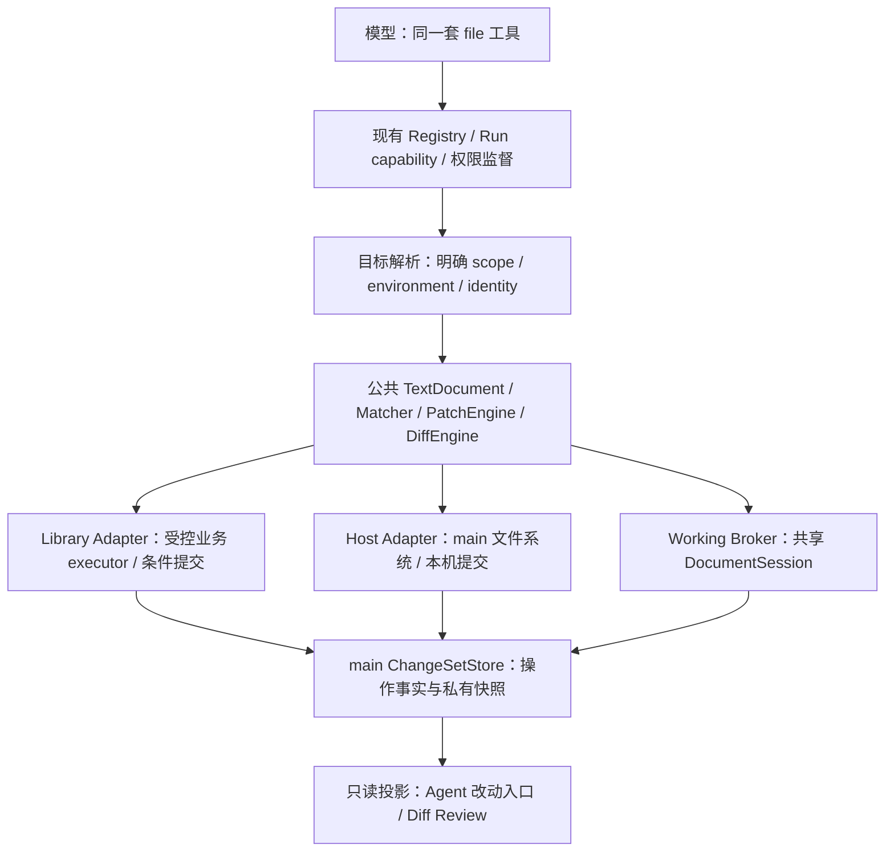

# Agent 内外文件统一工具、路径与独立 Diff 调研方案

更新时间：2026-10-21

状态：**saved 文件工具、相对路径解析、原生目录候选枚举、资料库解码复用及后台分页 Diff 已实现。** 前批全量检查和 macOS 非首 win 资料库主链已通过；本轮新增检查与实机范围以验证矩阵为准。第 2 节记录当前代码事实，第 12 节记录批次状态；第 4～11 节保留目标设计，未被当前事实明确列出的能力仍属后续方案，不能据此宣称已交付。

适用范围：内置 Agent 的资料库 / 本机文件定位、读取、检索、修改、编辑器草稿协作、改动记录与独立 Diff 页面。本文承接 [编码工具能力评估](./built-in-agent-coding-tooling-assessment.md)，不替代既有 [Agent 架构](./built-in-agent-architecture.md)、[Shell 架构](./built-in-agent-shell-architecture.md)、[宿主执行契约](./built-in-agent-host-execution-contract.md)、[UI 契约](./built-in-agent-ui-contract.md) 及 [Viewer 状态专题](./viewers/viewer-session-state.md)。

## 1. 推荐结论与边界

推荐采用**一套模型工具、一套公共文件语义、两个存储 adapter**。保留 `file.*`，把 `library` 和 `host` 当作明确命名空间；统一文本解码、分页、搜索规则、补丁和 Diff，底层分别接资料库条件提交与本机文件系统。不要求两种存储具有相同的事务、延迟或在线能力。

用户确认的设计取向：**充分告知能力和上下文，让 LLM 自主判断与行动，尽量少设流程干预。** 运行时负责把每次调用准确执行到指定目标，不另建自然语言意图裁判、固定搜索顺序或普遍澄清门禁。模型可以自主选择内部 / 外部、搜索范围、读取方式与下一步，找不到时也可以调整判断、询问或停止。

主要产品决定：

1. 向模型明确开放资料库与本机两种能力，由模型根据用户意图和上下文选择 scope。省略 scope 时仍使用当前资料库以保持旧协议兼容；这只是参数缺省值，不是要求模型优先内部的硬规则。
2. 当前只读取 / 修改权威已保存正文；修改工具只接受 `view=saved`。`working` 及共享工作副本是后续设计，当前不能显式选择。未保存内容不自动当成 Agent 输入，也不被顺带保存。
3. 新增正式 `file.patch`，不再要求模型为修改几行重述整份正文；保留 `file.write` 服务新建和完整重写。两者复用同一提交通道。
4. Diff 放在 **Agent 页面独立“改动 N”入口**，进入文件列表与差异查看，不放进文件树、文件 tab 或普通编辑器，不使用全局阻塞 Modal。
5. 改动记录由主进程独立持久化，UI 只读投影。只有确认提交的内容才称“已保存”；草稿修改、提交未知、记录不完整分别表达。
6. 先修后台草稿弹框与错误 dirty，再逐步迁移共享文档 owner。不能为 Agent 复制一份可写 buffer，也不能只删除 Modal JSX。

仍未实现：`working`、`resourceRef`、持久项目根 / 跨设备执行环境、workspace / 资料库全文索引、正文流式扫描、通用文件版本系统、自动回滚、多文件强事务、任意 Shell 写入的完整归属证明。Windows / Linux 不作已验收承诺。

## 2. 当前事实与差距

### 2.1 当前统一能力

| 能力 | 当前事实 | 主要差距 |
| --- | --- | --- |
| `file.list/search/stat/resolve` | `scope=library|host`，省略时为 library；支持相对 path / basePath；host 文件候选可用 rg 原生枚举后统一筛选 | search 是名称 / 元数据检索；无 ref、working 摘要或持久项目根 |
| `file.read` | 两 scope，读取已保存 UTF-8 正文，源文件最多 8 MiB；资料库按 Run 复用解码文本和行数组，可直接读路径 | 不读编辑器草稿；仍完整读源再分页，没有网络 Range / 持久行索引 |
| `file.grep` | 两 scope 共用 literal / `rust-regex-v1`、include/exclude Glob、Unicode 列、版本与游标；host 文件候选使用 rg 枚举，正文快照经 stdin 匹配 | 无正文流式扫描、全文索引或共同 gitignore profile |
| `file.write` | 两 scope 的 saved 新建 / 全文替换；正文最多 32,000 个 JS UTF-16 code units；替换要求 revision，创建不覆盖同名文件 | 不处理 working、批量事务或自动回滚 |
| `file.patch` | 两 scope 的 saved 单文件 `unified-v1` 严格上下文补丁；要求 revision，保留 BOM 与未修改区段的换行字节 | 补丁不能创建 / 删除 / 改名；无模糊匹配、dryRun 或 patchPlan |
| 文件刷新 / 草稿 | 保留原节点事件刷新；dirty 与基线比较，恢复改为文档内只读比较 / 恢复条 | 未迁移共享 DocumentSession；事件和 remount 仍不是完整版本协调协议 |
| Diff | main 持久化实际快照与提交状态；独立“改动”入口，支持单次 / 受限 library 净 Diff，worker 计算、可取消分页和有界缓存 | host 只看单次；无模型 `file.diff`、并排 / 虚拟 Diff 或完整 Shell 捕获 |

当前统一 resolver 在审批前固定规范目标。library 相对路径以显式绝对 `basePath` 或当前目录 ID 的权威路径为基准，无当前目录时使用 `/`；不能越过库根。host 支持当前平台绝对路径、home-relative，以及带显式绝对 / `~/` basePath 的相对路径；缺基目录明确提示补充 basePath（resolver 错误码 `HOST_BASE_PATH_REQUIRED`），绝不使用 `process.cwd()`。file.list 默认当前目录，file.search 未指定 path/basePath 时保留全库检索。工具不暗换 scope；library 的 `~/`、Windows drive / UNC 形状提示改用 host。模型原始参数保留在预算历史中，审批、审计、prepare、执行和快照共用独立规范输入；两份输入均检查敏感信息与审计限额，拒绝时同步清洗原始历史。host Shell 仍使用原独立 cwd 契约，不因结构化 resolver 自动改变。

`file.read` 默认输出预算为 10,000 tokens，实际受模型和剩余上下文约束；行列从 1 开始，列按 Unicode code point。续读带原始源字节 SHA-256，版本变化则拒绝续读。资料库强 ETag 缓存同时保留原始字节、解码文本与行数组，共计 16 MiB / 最多 16 项，受 TTL 与 Run 生命周期约束；每页仍复验权限及条件 GET，不把缓存当权限源。“只向模型返回几行”不表示网络只下载几行。

`file.grep` 每次最多 50 文件 / 20,000 行、默认 50 / 最多 100 条匹配行、0～3 行上下文、约 8 KB 匹配 / 错误条目输出和 15 秒软扫描预算。host 递归文件候选使用 `rg --files --hidden --no-ignore --no-follow --null --no-config`，最多 8 并发读取候选元数据；混合 / 目录查询保留 JS。file.search 自身的 Glob / keyword 在元数据读取前筛选，grep 的 include/exclude 在候选元数据之后、正文读取之前筛选。每页重新枚举并校验排序指纹，仍是 live 查询。正文仍完整安全读取、hash、解码后形成有界快照，经 rg stdin 匹配，不是对象存储 Range 或正文流式引擎。`complete=false` 或存在 skipped 时，不能声称“全部查过，没有匹配”。

Glob 继续使用共同 minimatch 语义：支持 `*`、`**`、`?`、字符集，不区分大小写、包含隐藏文件，不支持 brace / extglob / `!`。grep 新增 include 任一命中、exclude 任一排除；旧 glob 作为附加 AND 筛选。它们不直接转成 rg `-g`。`ignoreMode` 当前只接受 `none`，不自动遵循 `.gitignore` / `.ignore`。

两 scope 使用随应用提供的固定 rg（`@vscode/ripgrep` 1.18.0，当前二进制 ripgrep 15.0.0），路径由 main 私有平台层解析，不依赖 PATH、用户 Shell 或其他应用。构建时按 lock 中的 tarball / SHA-512 制备资源并保留 LICENSE；macOS 合并 arm64 / x86_64，复制到 asar 外并纳入签名配置。应用运行时不下载程序。固定参数数组、`shell:false`、`--json --no-config --engine=default --encoding=none`，不接受模型自填 flag；UTF-8 已由公共读取器验证，关闭二次解码以保留续页开头的 BOM 字符。`mode=regex` 使用 `rust-regex-v1`，不支持 PCRE2、lookaround、backreference 或跨行。literal 的不区分大小写沿用 ECMAScript lowercase，两端先做相同归一化；regex 使用 rg 的 Rust Unicode simple fold。资源缺失时 literal 和候选枚举等价回退，regex 明确不可用；其他枚举错误不偷偷降级。取消、超时和输出超限结束子进程；搜索失败文件保留 skipped/code 与不完整标志。每匹配行仅返回首个位置，column/endColumn 按一基 Unicode code point、末端 exclusive，未实现 occurrences 数组。

### 2.2 用户未保存时 Agent 看见什么

当前 Agent 的 `file.read/grep` 读取**已保存的文件正文**，不读取 TextViewer 的私有 buffer。`file.write/patch` 的 committed 表示 adapter 已确认保存：library 走资料库持久化，host 走本机文件系统提交；uncommitted / commit_unknown 不表示保存成功。

人工保存与 Agent 资料库保存都复用 `updateNodeFileContent`。已有文件修改先比对完整字节 hash，再以 `expectedStorageKey` 条件提交。权限一致不表示可以忽略草稿：人工未保存内容和权威保存内容可能是两个分支。

### 2.3 原始全局弹框的成因

已证实的调用链：

```text
Agent 资料库提交成功
  → notifyLibraryFileContentChanged
  → FileViewerContext 更新 fileUrl / reloadToken
  → FileDispatcher 的 key 改变，后台保活 Viewer 也可能重挂
  → TextViewer 比较最新正文与耐久草稿
  → draftRecovery 非空即显示 Modal，未要求 active
  → Portal 挂在全局，覆盖当前 Agent 页面
```

这是本轮修复前的调研基线：草稿恢复与展示时机问题，不是 Agent 写入权限弹框。原 `handleChange` 总置 dirty，不与保存基线比较；Undo 回原文也可能留下伪 dirty / 草稿。源码尚不能证明截图中的具体草稿来自哪一次人工编辑，不能把这一推断写成已复现事实。

当前已移除全局恢复 Modal，改为对应文档内的恢复条、只读版本切换及导出 / 另存为入口；未选择前仍保护编辑 / 保存。dirty 与 CodeMirror 同表示的基线比较，Undo 回基线恢复 clean，同内容 / 仅换行表示不同的残留草稿可清理。刷新前先 flush 草稿，失败保留缓冲区；保存期间新输入和旧资源迟到结果有代次保护。正文 owner 仍是现有 TextViewer / DraftStore，并未借此实现共享 working。详见 [Text Viewer](./viewers/text-viewer.md)。

### 2.4 saved 修改、历史 Diff 与本轮自动化

修改工具共用严格文本补丁与既有权限 / 提交监督，不给普通 Shell 增加新流程门禁。library executor 继续复用当前内容 API 与 `expectedStorageKey` 条件提交；host 接入 main 的普通单链接文件读取、同路径应用内串行、同目录临时文件、提交前身份 / hash 复验与替换。host 保留普通 mode / owner，ACL、xattrs 等扩展元数据未保障；外部进程的 compare→rename 窗口仍存在，不能宣称文件系统 CAS。`file.patch` 输入上限 128,000 UTF-16 code units，源 / 结果文本各不超过 8 MiB。

私有 journal 由 main 的 `agent-file-change-store` 持有，按 backend/account/library/session/run/toolRun 关联，原文不进入 Tool result / Provider 历史。写快照前先持久化 cleanup 占位与计费；准备成功后落 durable unknown，再允许真实提交。结算仅结束一次 active lease；缺少确定回执保留 unknown，重启或迟到成功不自动改写归属，不自动重放。快照有 SHA-256 校验，历史 after 不读取当前文件替代。

当前专用配额与保留策略已写入 store：单个 before / after 各最多 8 MiB，before+after 按字节计费；每 Run 64 MiB、每 backend/account 本设备 512 MiB；每 Run 最多 1,000 条、每 owner 最多 20,000 条元数据 / cleanup 记录，过期元数据仍占记录额度。committed / uncommitted 快照保留 7 天，unknown 14 天，均从创建时间计算；活跃准备 / 待结算操作不被 sweep 清理。过期只让快照不可用，unknown 状态仍保留。会话级联删除与 cleanup outbox 由 SQLite 触发器处于同一事务，删除文件成功才释放 outbox 占用，失败留账并在后续 sweep / 重启重试。此版不做内容去重，不接共享 quota manager，也未实现长驻查看 lease、导出后腾挪、跨模块磁盘余量计费或加密。

Agent 的“改动”区域读取只读 IPC 投影，显示记录范围、提交未知、快照失效及截断。最多查询最近 16 个实际 Run，列表最多 200 条并明确不完整；不将 continuation 合成一个新的执行 owner。单次 Diff 可用于两 scope；净 Diff 仅用于同一真实 Run、同 path / nodeId、全部 committed 且 before/after revision 连续的 library 链。host 路径不能证明文件身份，明确只提供单次操作。

Diff 使用独立打包的 Worker Thread，计算移出 store 串行队列；每线程 old generation 192 MiB / young 16 MiB / stack 4 MiB，5 秒硬超时，库级 1.5 秒 / maxEditLength=20,000。取消等待线程实际退出。每份源最多 200,000 行，总展示最多 4 Mi UTF-16 units / 4,096 页，每页默认 200 行、最多 500 行且最多 32 Ki units；长行可跨页并标记，UI 只渲染当前页。缓存 60 秒、最多 4 项 / 8 Mi units，同时最多 2 个读取，游标绑定 owner/library/session、真实快照端点版本、比较模式和 pageLines；续页重验记录归属和快照保留状态，失效明确返回首屏重读。切文件 / 模式 / 关闭取消旧请求，取消限定原 frame；导航 / 销毁释放任务。没有并排 / 虚拟 Diff 引擎，也没有向模型注册 `file.diff`。

macOS 预合并的双片 rg 和原生 helper 使用精确 `mac.x64ArchFiles` 路径跳过重复 lipo；真实 `@electron/universal` 最小 app 回归验证缺规则拒绝、完整规则成功、双片和字节保留、无关程序仍拒绝，未执行 helper GUI 能力。完整签名发行包仍未验收，不能以构建或最小夹具通过代替，详见[桌面平台契约](desktop-platform-architecture.md#43-agent-随包-ripgrep)。

定向自动化包括共同 matcher / rg / grep / Glob、真实临时 SQLite / 私有快照、路径归一与审批目标、32k 预算、raw / canonical 审计、真实 worker / 分页 / 取消，以及固定 rg 的制备 / ASAR 外布局 / 空 PATH 结构化搜索。最终全量检查见[验证矩阵](frontend-validation-matrix.md#agent-内外文件工具与独立-diff2026-10-21)。macOS 非首 win / 本机 MinIO 的真实 Agent 新建→读取→patch→读回、独立单次 / 净 Diff、人工草稿隔离及文档内恢复条已通过；续批本机相对路径 read→patch→read 成功。解锁后补验库内相对读取、随包 regex、host Diff 和 483 行 / 三页 Diff、亮暗主题；实机发现的重开旧游标问题已修复，两种关闭入口重开均回首屏，迟到响应与取消另有组件回归。560px 以下紧凑分支、长行分段、真实加载竞态及跨平台等未验项仍由矩阵明确列出，不以自动化替代客户端验收。

## 3. Codex 与 Git 对照

### 3.1 参考快照与阅读方式

本轮源码对照是 workspace 内 `project/codex`，commit `1a69ad3237fc485273ccfa9731239fdf789b43e4`，2026-10-13。它与本机安装的 CLI 0.153.4、旧评估引用的 `a9519cbcdd2d` 是不同证据身份。

该快照的通用本机读入口是 `exec_command/write_stdin`；模型可以调用 `rg`、`cat`、`sed`、`stat` 等，没有强制的“先看大小，再全文读，再局部读”状态机。提示词推荐 `rg` 搜索与 `apply_patch` 编辑，这是能力与指令设计，不能当作模型行为频率的统计结论。

推荐的常见阅读策略是先搜路径 / 关键字、再读相关区段；小文件也可以直接读。OmniFlow 不应强制每次先 stat，`file.read` 应自行控制源大小、输出预算、分页及错误。

Codex 的执行环境先选 environment，再相对它的 cwd 解析 workdir，不使用客户端进程 cwd 代替。可借鉴显式环境和冻结基目录，但它没有替 OmniFlow 解决“资料库根与本机根都用 `/`”这一自有命名空间问题。

### 3.2 局部修改与实际写盘

`apply_patch` 让模型输出局部变更；执行器仍读取原文、校验上下文、合成新全文并写盘。局部修改描述与底层整文件保存可以同时成立。OmniFlow 的资料库存储不需要为了支持 patch 改成“对象存储局部改几个字节”。

Codex 有空白 / Unicode 标点宽松匹配；本方案不照搬模糊匹配，因为跨存储的一致性与不误改更优先。单纯内容 hash 也不能证明模型读完全文：拿局部读取的 revision 去覆盖完整正文，仍可能通过版本校验，专用 patch 才能减少这一类错误。

### 3.3 三种 Diff 不能混用

| 比较 | 基线 → 结果 | 是否必须 Git |
| --- | --- | --- |
| 单次补丁 Diff | 本次操作实际 before → after | 否，文本 Diff 库即可 |
| 本轮净 Diff | 本轮首次记录基线 → 本轮最后确认结果 | 否，需要保留快照与连续性事实 |
| Git 工作区 Diff | 明确的 HEAD / index / worktree 两端 | 需要仓库信息；语义取决于参数 |

Codex turn tracker 累计可识别 patch 的 old/new，不是持续监控整个文件系统。普通 `sed`、Python 或重定向写入不自动等价进入该 tracker。后续 patch 读入的原文可能含外部修改，因此累计差异也不能无条件宣称完全由 Agent 产生。

该快照 TUI `/diff` 使用 `git diff` 比较 index → worktree，并另外列举 untracked 做 no-index；未传 `HEAD` 或 `--cached`，纯 staged 改动不会自然显示。不能笼统称“全部 Git 修改”。

本机安装 Git 后，`git diff --no-index -- before.txt after.txt` 可比较仓库外两份文件，exit 1 表示有差异。但 Git 不会因已安装就自动保留旧正文；仍需提供两份内容。`rg --replace` 只改变打印结果，不写回源文件。

## 4. 目标架构与唯一 Owner

本节保留完整目标架构，**不是全部现状图**。saved 两 adapter、公共补丁、路径 resolver、main journal / 后台只读 Diff 已实现；共享 TextDocument / DocumentSession、Working Broker、跨窗口文档 lease 仍是后续方案。



| 事实 | 唯一 owner | 其他层允许持有的内容 |
| --- | --- | --- |
| Session / Run / ToolRun / 审批 | 现有 main + SQLite | renderer 的规范投影，不能为 Diff 新建一套执行状态 |
| 资料库已保存正文 / 版本 | 后端与对象存储的权威绑定 | 授权后不可变 snapshot / 有界缓存 |
| 本机已保存正文 | 选定设备 / 环境的文件系统 | 文件身份、观察版本与不可变 snapshot |
| 工作副本 / 基线 / dirty / 编辑代次 | 目标 DocumentSession 服务，正式替代 Viewer 私有正文 owner | Viewer 显示、Agent 受控快照、DraftStore 耐久恢复副本 |
| 文件 tab / 阅读现场 | 既有 FileViewerContext / ViewerSessionRegistry 分工 | 引用文档，不把正文塞进阅读 snapshot |
| 文件变更记录 / 快照生命周期 | 新的 main ChangeSetStore | UI 分页、统计与 Diff 投影 |
| Diff Review 的选中文件 / 滚动 / 展开 | renderer 局部展示状态 | 不反向授权写入，不改 Run 结果 |

Library adapter 初期继续使用既有受控 renderer 业务 executor，不把认证头、MinIO 凭据或上传流程复制进 main。main 持有操作关联、封存快照与提交结算；renderer 只能经可信 executor 报告准备内容和真实回执，不能把模型提供的任意 before/after 直接登记成事实。

Working 的推荐落点是应用级 renderer 文档服务，先将 CodeMirror 的文档状态 / transaction 从视图组件迁入该服务，视图只附着到同一个状态。main 通过 owner / resource / generation 绑定的 broker 访问，不另维护一份可写正文。跨窗口通过 main lease 注册唯一可写文档 owner；其他窗口附着只读投影或显式交接，不能各自拥有同一 working 的权威。该迁移需要先验证 CodeMirror state / undo 的接管方式，再开启 working 写入。

## 5. 路径：自然语言理解与执行定位分开

相对 path / basePath resolver 已实现，当前规则见第 2.1 节。以下 ref、跨设备 environment 身份和完整 `FileExecutionContext` 保留为后续设计；没有新增 `resourceRef`、命名空间简写或持久项目根。

### 5.1 模型理解意图，工具执行明确参数

`/notes/a.md` 可以是资料库逻辑绝对路径，也可以是 POSIX 本机绝对路径。`/Users/...`、`/tmp/...`、`~/...` 是模型判断本机意图的常见线索，资料库上下文、选中项和引用则提供内部目标信息。不要求用字符串规则把这些线索穷举成固定优先级，也不因理论上存在另一种解释就弹出澄清。

推荐对用户保留自然说法，对模型和执行器使用结构化目标：

| 字段 | 含义 |
| --- | --- |
| `scope` | `library` 或 `host` |
| `resourceRef` | 受 owner / 环境 / 生命周期绑定的不透明引用，与 `path` 二选一 |
| `path` | 在已选命名空间中解析的路径 |
| `environmentId` | host 的设备 / 执行环境；v1 只有本机也保留身份 |
| `libraryId` | 当前 Run 可访问的目标库，由受控上下文绑定，不任由模型越库 |
| `view` | `saved` 或显式 `working` |

工具参数与结果清楚标出 scope 和规范路径，UI 必要时显示“资料库 Win · /笔记/a.md”或“本机 · ~/work/a.md”。用户可以一直使用自然语言，不必学习特殊路径语法或先选工作模式。`library:/笔记/a.md`、`host:~/work/a.md` 可作为可选显式简写，归一到结构化目标；不要求将这套简写作为基础功能的前置条件。

建议将用户输入的 `~` / `~/...` 保留为 host-home 简写，相当于明确的本机意图；资料库中名为 `~` 的目录写作 `/~/...`。工具若同时给出 `scope=library` 与 home-relative path 则报冲突，不能静默重写 scope。

### 5.2 提供信息与自主选择

提示和工具描述需要准确告诉模型：可以操作资料库，也可以操作本机；使用同一套 `file.*`，通过 scope 选择；当前库、目录、选中文件、活动文档、本机环境 / home / cwd 分别是什么；各项信息是否已知。引用和最近读取结果是定位帮助，不是强制的工具调用链。

模型自行结合这些信息理解请求，然后在调用中填写明确的 scope/path 或 resourceRef。执行器只校验调用参数的一致性与访问条件，不重新阅读用户自然语言并要求模型证明“为何选择外部”。同一请求中同时有附件和本机路径也不自动触发冲突；模型可判断是背景、来源、目标或另一个文件。

如果一次结构化调用同时给出相互矛盾的 ref/scope，返回 `TARGET_CONFLICT` 供模型修正参数，不直接向用户弹框。模型可以自行搜索、读取、调整路径、在另一 scope 发起新的查询；只有它认为现有信息确实不足以完成请求时，才使用现有交互询问用户，或清楚说明无法继续。

建议提示保持简短，例如：

> 你可以使用同一套 file 工具读取、搜索和修改当前资料库及本机文件，scope 分别为 library 与 host。当前上下文会列出资料库目录、选中文件与可用本机环境；省略 scope 时兼容默认 library。请结合用户请求自主选择目标和工具，必要时调整搜索范围或查询另一来源；信息不足时可询问用户。工具结果中的来源、版本、完整度和提交状态表示实际执行事实。

不增加“必须先 stat / resolve”“必须先查内部”“看到裸 `/` 必须询问”等固定步骤。明确用户引用和指令仍是模型理解任务的依据，系统不需要再实现一套自然语言优先级引擎。

### 5.3 模型可参考的例子

以下是理解示例，不是运行时必须执行的分流表。模型可以依据更完整的对话得出不同判断。

| 用户输入 / 上下文 | 可能的合理判断 | 工具需要表达的事实 |
| --- | --- | --- |
| “修改这个文件”，附库内文件引用 | 使用该引用，选择 library | 引用身份与 view |
| “修改本机 `~/work/a.md`” | 选择 host | 选定环境及 home 展开后的路径 |
| “资料库里的 `/Users/example/a.md`” | 选择 library | `/Users` 在这次调用中是库内目录名 |
| “查看 `/笔记/a.md`”，普通库内聊天 | 通常选择 library | 实际查询的库与规范路径 |
| “修改 `src/a.ts`”，此前已在本机项目工作 | 通常继续选择 host | 本次使用的项目基目录 |
| “查看 `./a.md`”，普通资料库聊天 | 通常选择 library 当前目录 | 本次使用的库内基目录 |
| “修改 `/tmp/a.md`”，虽在库内聊天但路径明显像本机 | 模型可判断为 host，不被默认 library 限制 | 查询结果明确标 host；若未找到，模型决定下一步 |
| “把库内报告保存到 `~/Desktop/report.md`” | library 来源与 host 目标 | 两端分别绑定，不使用一个全局 scope 覆盖整句话 |
| “继续上个本机项目” | 从对话和已知信息判断项目，可自行核对 | 当前执行设备与真实路径 |
| Windows `C:\work\a.md` / UNC | 判断 host 并检查可用环境 | 平台支持 / 不支持的真实结果 |

### 5.4 上下文快照与单次操作绑定

未来完整设计为 Run 启动时增加只读 `FileExecutionContext`：owner、libraryId、libraryBaseDirectory 的 ID / 规范路径、selected resource refs、独立的 activeEditorResourceRef、defaultScope、host environmentId / cwd / home / platform、上下文版本与有效期。树选择与活动编辑文档分别表达，不能互相冒充。当前实现继续使用 `AgentAppContext`，在单次调用审批前按权威目录 ID 解析并冻结规范输入，没有创建完整的新上下文模型。

用户切库、切目录、选中文件或切窗口后，已准备 / 正在执行的调用目标不漂移。上下文快照是模型的起始信息，不是把整个 Run 锁死在一个目录：模型可在同一 Run 的后续调用里自主指定不同 scope、目录和文件，无需用户重新选择工作模式。每次调用各自绑定目标；在途提交不被后续选择改写。

初期保持现有 Agent Session 限定当前库；显式指定另一库时返回不支持并提示进入对应库，不能让模型自填 libraryId 绕过 broker。跨库与跨设备目标属于后续独立扩展，不由统一 schema 自动获得权限。

当前 library 相对路径使用显式 basePath / 当前目录，`..` 不能越过 `/`；host 使用本次显式 basePath，允许按当前平台规则归一 `..`，basePath 本身不是新增沙箱根。logical library path 不调用本机 `path.normalize`。新建文件解析父目录，不要求文件已存在。未来若加入 host workspace 授权根，须另外明确其权限边界，不能把本次基目录误称授权根。

结构化 host 路径只支持 `~` / `~/...` 展开到**选定环境**的 home；不做任意 `$VAR`、`~otheruser`、命令替换或 Glob 展开。raw Shell 的 `~`、引号、环境变量与重定向仍由对应 Shell 处理，不把 `host:` / `library:` 简写直接塞进 Shell。

Windows 必须区分 `C:\foo` 与盘符相对的 `C:foo`；UNC、保留名、大小写、分隔符、长路径按目标平台校验。外平台绝对路径不能被本机误解后落到另一个目标。

### 5.5 引用、重命名与不存在

`file.resolve/read/search` 可返回 `resourceRef + canonicalPath`，后续使用 ref 不必重复猜路径。ref 不是授权凭据；每次复验 owner、库、环境、资源身份、当前权限与引用生命周期。它不直接包含 storageKey、签名 URL 或暂存路径。

resourceRef 模式从引用绑定事实推导 scope，只有 path 模式才应用缺省 scope。省略 scope 的 host ref 不能被兼容默认误解释为 library；若另给 scope 则仅作一致性校验。

库内稳定身份使用 backend/account/library/node；本机引用还需环境、文件身份与 generation，不能只持有字符串路径。删除后同路径重建，旧 ref 应失效，不能悄悄改指新文件。ref 与额外 scope/path 矛盾必须拒绝。

不存在时工具如实返回该 scope 的 NotFound；adapter 不在一次调用里悄悄换来源并返回成功。模型收到结果后可以自主另发调用，搜索另一目录或另一 scope，再判断哪个文件符合用户请求，无需为探索本身新增确认。引用过期也可以重新定位；新的调用绑定新的明确目标，旧 revision / 审批不随之挪用。

## 6. 公共工具契约

下表是完整目标契约，不能直接当作当前 schema：v1 没有 ref / working 访问、模型 `file.diff`、copy/move/delete 统一接口，也没有为全部结果补齐统一 envelope。`file.patch/write`、grep 的共同模式与部分状态字段已实现，准确输入 / 结果以第 2 节及工具 schema 为准。

所有工具继续进入现有 Registry、Run capability snapshot、权限监督、ToolRun、取消和安全结果投影。Provider 先使用共同 JSON schema；特定模型的 freeform grammar 可后续适配，不成为第二套执行器。

| 工具 | 目标契约 |
| --- | --- |
| `file.list` | 单层目录、类型过滤、limit/cursor；递归交给 search |
| `file.search` | 文件名 / 元数据搜索，root、keyword、include/exclude Globs、类型、分页；不暗示正文检索 |
| `file.stat` | 身份、类型、字节数、版本可得性、working/dirty 摘要；不为拿元数据强制下载全文 |
| `file.resolve` | 精确定位并返回 canonicalPath/ref；不是其他工具的必经前置步骤 |
| `file.read` | target/view、起始行列、可选行数、预期版本与输出预算；明确返回完整度和下一位置 |
| `file.grep` | root/view、literal 或明确 regex profile、大小写、Glob、上下文、预算 / 游标 |
| `file.patch` | 单文件 target/view、expectedRevision、`unified-v1` patch；完整预检后提交 |
| `file.write` | target/view、mode=create/replace、完整正文；replace 必须带 expectedRevision，create 同名即失败 |
| `file.diff` | 比较两份受控 snapshot/revision，明确 baselineKind；不要求 Git、不执行写入 |
| 后续 copy/move/delete | 独立操作与风险语义；跨 scope 的 source/destination 分别解析，不把跨存储移动伪装成原子 rename |

建议结果公共字段：target/ref、canonicalPath、view、revision、limits、warnings；分页加 `hasMore/nextCursor/coverage/stopReason`，目录扫描标 `consistency=live`；变更加 `operationId/beforeRevision/afterRevision/writeCommitState`。错误用稳定 code，如 `TARGET_AMBIGUOUS`、`TARGET_CONFLICT`、`REVISION_CONFLICT`、`UNSUPPORTED_CAPABILITY`、`INCOMPLETE_SCAN`、`COMMIT_UNKNOWN`，不要让模型从中文错误句猜状态。

这些错误作为事实返回给模型，由它决定继续检索、修正参数、改用另一明确来源、询问或停止；错误码本身不启动强制用户澄清或额外审批。

匹配结果保留按行组织，每行可带多个 `occurrences[]`；不可让一个 adapter 按行计数、另一个按 occurrence 计数。游标绑定查询、权限范围、资源 / 索引版本；它不是访问凭据，模型投影截断时不能发出跳过尚未交付结果的游标。

版本分层：

- `contentHash`：原始字节 SHA-256，不正规化 BOM、换行或 Unicode。
- `savedRevision`：权威保存版本与资源身份；library 使用后端版本 / 存储绑定，本机使用可观察身份与内容版本，公开其并发保证。
- `bufferRevision`：共享文档 epoch + 单调 generation，另带 `baseSavedRevision/dirty`。

模型只回传 opaque revision，不自行合成。updatedAt、文件大小、临时 URL 都不能替代强内容版本。旧 read/write 参数经兼容层映射，新旧范围参数不能同时填写。

## 7. 文本、检索与性能

本节保留公共文本与性能目标。当前已实现 read/grep 的 code-point 坐标、严格 patch 字节保持、共同 matcher、host 原生 rg 候选枚举、资料库 Run 内 decoded / 行数组复用。网络 Range、正文流式扫描、持久行索引及 workspace / 资料库全文索引尚未实现。

### 7.1 同一文本坐标与字节保持

对模型统一一基 line/column，column 按 code point，范围 endExclusive。CodeMirror 的 UTF-16 offset、rg 的 UTF-8 byte offset 都经过公共 codec 转换。code point 不等于视觉字符；组合字符和 ZWJ emoji 的视觉宽度不能拿来算 patch 位置。

公共 TextDocument 保留原始字节、BOM、行终止符偏移与 EOF 信息。read/grep 返回逻辑文本，patch 只改变命中的区段；未触及的混合换行与字节不因保存被整份 LF 化。插入换行采用明确规则并返回元数据。空文件、无尾换行、超长行和 EOF 必须有契约样本。

传输 / 快照配额统一用 UTF-8 bytes；位置和模型字符不是同一单位。迁移前准确保留现有 32,000 UTF-16 units 的描述，不直接改成“32,000 个 Unicode 字符”。

### 7.2 如何接近 rg

rg 的优势是成熟正则、流式扫描、目录剪枝、ignore、并发与结构化输出。当前除共同 stdin 匹配外，还把 host 文件候选枚举交给原生 rg；公共 Glob 在应用层先筛选，再并发读取匹配元数据。没有直接把公共 Glob 转 rg `-g`，也没有因此实现正文流式扫描或目录索引。

可复现基准为 `npx vitest bench --run electron/service/agent/agent-file-performance.bench.ts`，最终使用默认随包 rg 15.0.0。macOS warm FS 合成 2,010 文件 / 100 目录、10 个 Glob 命中：顺序 describe 后筛选平均 25.9453 ms，新候选枚举 / 先过滤 / 8 并发元数据平均 11.3943 ms（2.28 倍）；应用 describe 计数 2,111→11，不含根复验和 rg 内部 I/O，不能称总 syscall 数。1.5 MB / 50,000 行 mixed UTF-8 / CRLF 的热页 hash+decode+split 为 4.3335 ms，hash+decoded 复用为 0.4435 ms（9.77 倍）；这是 CPU 样本，不含网络或权限复验，不代表端到端提速。

调研建议先冻结共同 literal / Glob profile，再加入共同单行 regex profile；当前已采用第 2.1 节所述的固定随包 rg 默认引擎与明确 literal fallback。WASM matcher 仍属可选替代方案。继续不承诺 lookaround、backreference、PCRE2 或跨行搜索，不用一端 JS RegExp、一端 rg 来冒充一致。

Host adapter 可以把 rg 当私有加速器，但只有等价性样本通过后才替换公共匹配；不等价时回公共 matcher，不能漏检后再核对。直接 spawn 固定二进制与参数数组，固定 `--json`、禁用用户 config、显式 hidden/ignore/symlink/encoding，不接收模型任意 flag，不经 Shell 拼接。二进制缺失时使用等价公共实现或明确不可用，不静默降低 regex 语义。

忽略规则显式公开：当前只支持 `ignoreMode=none`；主动选择的 `git` profile 属于后续扩展，必须两端具备同一语义才开启。公共 include/exclude Glob 不直接转义成 rg 原生 Glob 后假装完全等价。目录候选剪枝、解码 / 行索引复用和流式输出可分别优化。

### 7.3 资料库检索可在哪些方面更强

资料库有稳定节点身份、名称 / 标签 / 类型元数据，可提前缩小候选，并将正文匹配与版本、权限、草稿状态结合；这比只在磁盘上执行 rg 更容易形成一致的产品体验。单文件编辑器现有 CodeMirror 已支持搜索、正则、整词、替换和撤销；这不等于资料库已具备跨文件搜索。

长期全文索引应绑定 node identity、savedRevision、extractor/matcher version、index generation，具备新增 / 更新 / 删除、pending、stale、failed 与 watermark。索引是加速层，不能成为权限或文件存在性的事实源。

完整查询应由权威元数据枚举候选，校验索引版本，未索引项做有界在线扫描。离线 / pending / skipped 存在时不能报完整无匹配；预算耗尽返回 coverage 与游标。目录跨页是 live 扫描，不承诺整个目录的原子快照。

缓存键使用资源身份 + 版本 + decoder/matcher profile，保留当前 owner / Run 隔离、强 ETag 校验、TTL 与内存上限。mtime+size 只作候选检查，不能证明内容未变；主动事件失效不能替代读取时版本复验。

## 8. 局部修改、提交与并发

saved 单文件的严格补丁、两 adapter、准备快照与提交结算已进入 v1；本节的 dryRun / patchPlan、操作回执查询、working 状态与多文件协议仍属后续设计。本轮没有修改 Go 后端或增加幂等 receipt 查询。

### 8.1 补丁处理

v1 已固定 `unified-v1`：单文件、行号与上下文严格匹配、无尾换行显式表示。目标在结构化参数中确定，patch header 不得改指另一文件；不支持多文件 header 偷渡、路径逃逸、模糊空白修复或上下文多解时任选一处。当前 patch 只修改现有文件，新建与全文替换走 file.write，删除 / rename 未纳入该方言。

执行顺序：解析目标与权限 → 权威读取 before → 校验 identity/revision → 完整校验 patch → 生成 after bytes → 封存快照 / prepared operation → 受监督提交 → 核对回执 → 记录事实 → 发版本事件。模型只需读相关区段，执行器必须核对完整基线。

dryRun 可返回 `patchPlanId/planHash/baseRevision`；真正提交仍复验原目标、补丁、版本、权限，不能批准 A 后执行 B。

### 8.2 两 adapter 的保证不同

Library 继续走后端条件更新，拒绝陈旧版本。没有条件接口时明确不可用，不回退无条件覆盖。客户端计算的 after hash 与“服务端确认提交版本”分开记录，若缺少权威 receipt / 幂等查询能力，列为后端依赖。

Host 推荐应用内同资源串行、读取 / hash / identity 校验、同目录临时文件、保留必要元数据、flush、提交前复验、同文件系统 replace、提交后核对。但 **compare + rename 不是对任意外部进程的 CAS**：复验与 replace 间仍有 TOCTOU。只能声明应用内合作串行与尽力的外部并发检测，不能宣称绝对防覆盖。

Host v1 明确普通文件边界；符号链接、硬链接、父目录替换、只读、ACL/xattrs、mode、跨卷与 Windows sharing violation 单独测试。不能用原子 rename 造成硬链接语义变化后仍当作原位编辑。遇到未支持身份 / 元数据应拒绝或明确给出支持范围，不暗中降级到危险覆盖。

### 8.3 状态与失败

| 状态 | 意义与后续 |
| --- | --- |
| `uncommitted` | 有证据未提交；可以在重新准备后重试 |
| `committed` | 有权威提交回执；刷新 / UI 回执失败不能抹掉已保存事实 |
| `commit_unknown` | 可能已提交但未确认；查询 operation receipt / 当前版本，禁止盲目自动重放 |
| `applied-to-buffer` | 仅修改工作副本，未持久保存；不能显示“已保存” |

operationId 进入提交结算，重复调用要能识别，不能只在 UI 去重。现有后端缺少可查询操作回执时，仅凭“当前 hash 恰好等于 after”不够证明作者归属；显示结果已观察 / 归属未确认。

多文件先全量预检也不代表原子提交。中段失败逐文件报告真实状态；取消不撤销已经成功的文件，禁止默认自动回滚并覆盖期间的新修改。

## 9. 工作副本、自动保存与冲突体验

本节的共享 working、bufferRevision、自动保存与三方合并均为后续设计。v1 仅完成 saved 修改和原 TextViewer dirty / 恢复体验修复，继续由人工明确选择恢复草稿，不向 Agent 暴露 working。

### 9.1 默认策略

| 情况 | 建议行为 |
| --- | --- |
| Agent 对 saved 操作，Viewer clean | 条件保存；以版本事件更新正文 / 基线，保留阅读现场，无弹框 |
| Agent 对 saved 操作，Viewer dirty | 保留人工 working；更新外部 saved 版本，在对应文档显示非阻塞分叉提示，不抢 Agent 焦点 |
| 显式 working，目标 clean | 经共享 owner 应用；回执区分仅修改与明确请求保存后的提交 |
| 显式 working，已有人工 dirty | 按 bufferRevision 应用，保留人工内容和撤销边界，默认不保存整份草稿 |
| working 草稿尚未恢复 / 基线 stale | 返回结构化冲突，提供 base/saved/working 比较、另存或明确合并；不阻断 Agent 的其他文件任务 |
| 保存中继续输入 | 仅把已提交代次设为新基线，不清除更晚输入，不让迟到回执倒退正文 |

用户明确要求“保存当前编辑中的完整内容”才进入包含现有人工草稿的提交；普通“改这个文件”不自动等于保存此前未完成内容。若未来要默认 working，read / patch / 自动保存三者必须同批切换，不能只改读取来源。

working 初期只支持显式单文件。未打开文件的耐久草稿不能无条件胜出；需要 DocumentSession 恢复 / 分叉判断。目录级 working grep 只有具备完整草稿枚举与 overlay 后才开启，否则明确 unsupported，不用 saved 搜索冒充。

### 9.2 迁移与后台弹框修复

这一独立修复已进入开发 v1：Undo 回基线恢复 clean；内容相同的草稿可安全清理；后台不创建全局阻塞恢复框；真实分叉保留双方，以文档内恢复条和只读比较处理。仍用既有草稿 owner，没有新建 Agent buffer；当前自动化与尚未实机覆盖的边界见 Text Viewer 专题和验证矩阵。

之后按“人工加载 → 编辑 → dirty → 保存 → 草稿恢复 → undo”整体迁移 DocumentSession，TextViewer 的 content/ref 不再独立可写。Viewer 的 remount、失活与 tab 关闭不能决定文档真相的生死；关闭时仍按现有草稿耐久规则 flush。

新内容事件至少带 resource identity、source、operationId、before/after savedRevision、document generation。clean 可应用新基线；dirty 只登记 pending external revision。旧 operationId、旧账号 / 库 / owner lease 的结果不得写回新实例。

三方合并只在有 base/saved/working 时成立。无冲突区段可以生成建议合并；重叠修改保留双方并留在文档内解决。Diff 本身不提供自动合并正确性保证。

## 10. 独立 Agent Diff 入口

已接入 Agent 时间线中的独立只读改动区域，不进入文件树或普通文件 tab。当前为统一 Diff 文本、单次操作及受限 library 净链，使用可取消 worker 与文本分页；以下完整目标中的并排 / 虚拟 Diff、按语义 hunk 懒计算、内容寻址去重、working 归属和模型 file.diff 仍未实现。

### 10.1 用户流程

Agent 页面提供可键盘访问的“改动 N”按钮，显示当前 Run 的可用记录；结束后仍可在该轮任务中打开。同一会话可切换历史 Run，不用一个永久累计数混淆任务。

点击后进入独立 Review 区域：左侧文件列表（来源、完整路径、操作、增删统计、保存 / 未保存 / 未知 / 记录不完整），右侧选中文件的并排 / 统一 Diff。窄窗使用文件列表 → 单文件 Diff 的顺序视图，返回后保留选择与滚动。v1 只读，不提供接受 / 拒绝 / 一键撤销，查看 Diff 不代表批准或重放写入。

入口挂在现有 `AgentRunElapsed` 耗时 / 过程栏附近，工具过程折叠后仍可见。`N` 只计本模式已确认的不同文件，unknown 单独显示“待核对”；未来 working 需单独标“未保存”，不能用“改动 0”暗示没有可能的写入。当前时间线会合并 continuation 的多次 Run；Review 查询最近最多 16 个实际 Run，按真实 runId 分组并标“执行 N”，不提供独立 Run 选择器，不合并不同 Run 的净 Diff。归档会话可读保留中的 Diff，不恢复执行权限。

当前符合连续条件的 library 文件默认显示**同一实际 Run 已确认的净改动**，可切换单次操作；host 与断链 / 未知提交按单次查看。更广义的本轮净改动、working generation 比较属于后续目标。Git HEAD/index/worktree 是另一个明确模式，不能混成 Agent 修改记录。

大文件先给统计 / 限额提示，按文件与 hunk 懒加载；虚拟渲染、可取消计算、二进制摘要、无尾换行、BOM / 换行变化均明确表达。亮暗主题、100% 缩放、路径复制、焦点回到入口及中文长路径纳入验收。

### 10.2 变更事实与净 Diff

当前 main-only 实现为 `agent-file-change-store`，挂在现有 owner/session/run/toolRun 下，不复用 ToolRun.result 存正文；每次操作使用 UUID 命名的 before/after 文件与独立元数据。以下更细的 ChangeSet / FileChange / Snapshot 内容寻址模型保留为后续方案，尚未整体实现：

- ChangeSet：owner、library/environment 绑定、sessionId/runId、schema、保留时间、记录范围 / 完整性。
- FileChange：稳定资源身份、before/after 显示路径、操作序列、单调 sequence、统计和当前可用性。
- FileOperation：toolRunId/operationId、source、view、准备 / 提交结算、before/after revision、snapshot refs、连续性证据。
- Snapshot：内容寻址的私有 blob、字节数、编码、hash、引用计数、创建 / 过期状态；不能作为任意路径读取入口。

单次操作 before/after 必须来自执行器的实际字节。净 Diff 不能简单拼 patch：以首次基线到最后确认结果重算。只有相邻 `afterRevision == next.beforeRevision` 且 identity/view 连续，才合并成连续链。

检测到人工 / 外部交错修改、缺少快照或未知提交时，拆分链并显示“期间包含外部变化 / 记录不完整”。不能把全部差异归给 Agent，也不能用当前文件覆盖历史 after。恢复旧历史时展示当时快照；“与当前文件比较”属于新的明确比较。

对已确认连续 library 链的 A→B→A 不计净改动数，单次操作历史保留；不捕获结构化删除 / rename，host 不聚合。新建后删除净空、rename 展示及更完整身份事件仍是后续目标。当前 worker 的线程内存 / 5 秒期限与分页预算见第 2.4 节；它是 Worker Thread 隔离，不是独立 utility process 或系统级总内存保证。

working 操作也可记录，但必须标未保存。后续保存整份人工 + Agent 草稿时，持久化的是整份文件，Agent attribution 仍只来自可追踪的 transaction；不能把保存动作中所有差异据为 Agent 改动。

### 10.3 写入与记录不能靠结果文本补救

当前 Tool 结果会脱敏 / 截断，Run 收尾可能改写未完成 Tool 的结果；Shell 日志 / 媒体产物有各自较短 TTL，因此都不适合作为完整文件历史仓库。

结构化写入的推荐流水线：

1. executor 读权威 before、生成 after，main 在有界配额内封存快照和 prepared 元数据。
2. 进入现有受监督 committing 边界，执行 adapter 条件提交。
3. 权威回执确认后，将 operation 标 committed；超时 / 取消保留 unknown，不能因 Run stopped 改成未提交。
4. UI 刷新与规范结果投影独立完成，失败不反转提交事实。
5. 重启对 prepared / in-flight 做核对，使用操作回执优先；仅能观察当前内容时不伪造精确提交时间 / 归属。

v1 已在提交前无法保留最小快照时明确拒绝；独立清理 / 导出记录产品入口尚未实现。提交后记录落库失败仍保留已保存事实与待恢复 journal，不能要求自动重写文件。重启不会自动查询后端 operation receipt 或将 unknown 洗成成功，后者需要未来的可验证回执协议。

这一策略仅约束声明可审计的 Agent 写入，不让普通人工保存因为 Diff 历史配额耗尽而失败。journal 的 pending / unknown 恢复应先于通用 Run finalizer；现有 SQLite 为 WAL + synchronous NORMAL，不宣称已具备硬断电后绝不丢最近记录的保证。schema 接入现有 coordinator / 自检与初始化 barrier，不能在业务 Store 随意补表或自行更改 canonical schema 编号。

### 10.4 快照保留与隐私

当前已实现专用配额：单份 before / after 各 8 MiB；每 Run 64 MiB、每 backend/account 本设备 512 MiB；每 Run 1,000 条、每 owner 20,000 条记录。committed / uncommitted 快照 7 天，unknown 14 天，active 准备 / 待结算不清理；期满只清正文，不改操作状态。达到硬上限时拒绝新的受审计写入。数值是当前开发默认，尚非性能容量测量结论。

当前 SQLite 账本计算未去重的 before+after 字节、准备 reservation 与失败清理占用，并为元数据另设数量上限；不宣称精确物理空间、临时文件 / DB 开销或全应用聚合配额。现有共享 quota manager 的默认最大 TTL 为 24 小时，本版没有复用它；未来若统一计费，需要专用 category 与显式策略，不能只改 expiresAt。

当前 active 操作持准备 / 结算 lease，尚无跨响应的查看 lease。过期快照清理后保留“内容已过期”的元数据，仍占记录数量配额。unknown 不自动重放，期满仍保持 unknown 并标快照不可用，不能把状态洗成失败或成功。

当前删除会话级联删除关联记录，再按 outbox 清理独立快照文件，不使用引用计数或共享 blob。未来若做去重，只能在同一 owner 分区内；账号切换 / 登出仍须遵守现有 owner 边界，不得借历史 Diff 扩大访问范围。

本版 schema 已通过 coordinator / bootstrap 注册清理触发器：会话 cascade 删除记录时，在同一 SQLite 事务写入不随 cascade 消失的 cleanup outbox。物理删除在后续 sweep 幂等执行；成功才移除 outbox 并释放占用，失败留账供下次或重启回收。准备快照前也先写同一类 cleanup reservation，避免失败准备遗留文件却失去计费 / 清理线索。

当前原文快照不放普通日志、模型历史或长 Tool result，位于应用私有目录，使用最小文件权限，不宣称已有加密。只读 IPC 接受 change ID，不接受任意快照路径；main 限定应用窗口、校验所请求 owner/library/session/run 归属，store 再隔离记录范围。完整目标还要求逐文件复验资源撤权，并支持有界 hunk / 内容页；本轮没有完成真实后端撤权验收，不能把当前归属校验等同于该目标。

当前本地 UI 的 Diff 使用真实快照，不先用通用脱敏器改写正文；点击查看不顺便把原文发送给 Provider。未来模型侧 `file.diff` 必须是独立的有界结果投影与授权路径，按现有外发策略处理并标明截断 / 脱敏，不能直接复用本地 exact Diff 外发。

启动清理处理 orphan blob / 临时文件，先核对 manifest 与引用，再删除；正常退出释放 lease，崩溃残留按代次 / TTL 回收。用户明确导出才复制原文到其指定位置；不自动同步本机路径和私有快照到其他设备。

### 10.5 Shell 覆盖边界

结构化 patch/write 可以精确记录；formatter / generator 可在明确工作集上做执行前后快照，标明其捕获范围。任意 Shell 的重定向、子进程、异步写入不能仅靠命令文本准确推断。

Git diff 可以补充当前工作区观察，不能证明作者、操作时间，也不能找回未保留的 before。文件 watcher 只能作检测线索，不能保证不漏中间版本。v1 明示“已记录的结构化修改”；扩展 Shell 捕获时公布工作集、限额、截断和外部交错，不能宣称所有 Agent 修改均完整记录。

## 11. 权限、上下文与兼容迁移

“和人一样写文件”的产品目标是使用相同权威保存接口与一致结果，不是跳过当前 Agent 的权限模式。本文不新增普遍确认弹框，也不把原草稿弹框误当审批；仍复用现有权限 / capability，授权后直接执行对应操作。

统一工具不等于 raw Shell 可直接操作资料库路径。资料库转换 / 编译继续走明确的 stage → 工作副本 → publish；不得把暂存路径当库内权威文件，也不得借 host Tool 绕过资料库权限。向模型说明结构化工具具备统一语义、版本与改动记录，Shell 适合生成器、编译、测试、Git 与复杂管道；由模型按任务选择，不把“普通文件必须走结构化工具”设为执行门禁。

调研时的兼容路线为：保留旧 scope 缺省值 / 参数 → 统一 resolver 与公共结果 → 增加 patch / host saved 写 → 正式 Diff 记录 → 迁移 working owner → 增强检索。实际先落地 saved 修改 / Diff 和共同 regex，本轮再补相对路径 / basePath、搜索与读取性能、后台分页 Diff。working 迁移和完整 ref / environment 模型仍待实施。缺省值服务旧参数与历史兼容，不约束模型的新调用选择。新能力未出现在当前 Run 有效工具视图时，提示词不能暗示模型已经可以调用。

## 12. 实施批次与代码落点

以下按本次代码现状更新；“已实现”表示开发代码与对应定向自动化已落地，不表示完整实机 / 跨平台验收完成。后端若增加版本 / 操作回执 / 全文索引，必须另读 `omniflow-go/AGENTS.md` 并遵守迁移与代码生成规则。

| 批次 | 当前状态与落点 | 尚未完成 / 验收边界 |
| --- | --- | --- |
| A：契约与独立问题修复 | saved 修改输入 / 版本错误、双 scope 提示、相对 path / basePath resolver 与审批前冻结、TextViewer dirty / 文档内恢复条 | 完整 resourceRef / FileExecutionContext、持久项目根与跨设备身份未实现；跨窗口及平台实机未验 |
| B：公共修改与记录基础 | saved 两 adapter、公共 unified-v1 parser、library 条件 executor、main 私有 journal / 配额 / TTL / outbox；真实 library 新建 / patch / 读回及 host 相对路径 read / patch / read 通过 | 无新后端 receipt、强外部 CAS、批量事务或完整 extended metadata；真实故障注入未验 |
| C：独立 Diff UI | Agent 只读入口、最近 Run 列表、单次 / 受限 library 净 Diff、可取消 worker、文本分页与版本绑定缓存、未知 / 过期 / 截断投影 | host 只单次；无并排 / 虚拟 Diff、语义 hunk 懒计算或模型 file.diff；实机范围另记 |
| D：共享文档 | 未实现；继续使用原 TextViewer / DraftStore owner | DocumentSession、working broker、bufferRevision、跨窗口文档 lease 与后续默认 working 迁移均属未来 |
| E：检索与性能 | 共同 literal/regex / include/exclude、固定随包 rg、host 原生候选枚举 / search 先筛选 / 并发元数据、资料库 Run decoded / 行数组缓存、明确 fallback / unavailable；合成 benchmark 已记录 | 无正文流式读取、持久行索引或 workspace / 资料库全文索引；续页仍重新枚举目录 |

本次按 A 独立修复、B 快照与提交、C 不依赖 D 的顺序推进，随后补 A 路径解析、C 后台分页和 E 性能。未来默认 working 是独立产品迁移，须追加验收，不能因 saved 能力已交付而默认开启。

## 13. 验收矩阵与待验证事项

下表同时包含当前待验证边界和未来批次要求；ref、working、索引等未实现项只在对应批次开启后验收，不能将表格整体标为本轮已通过。第 2.4 节记录检查摘要，完整全量与实机范围以验证矩阵新增记录为准。

| 维度 | 必须覆盖 |
| --- | --- |
| 目标 / 路径 | 模型知道两种来源、可自主选 scope / 在失败后另查另一来源、裸 `/` 不触发强制询问；同名内部 / 外部、`~`、相对路径、source/destination、ref 冲突 / 过期 / 删除重建、库切换 / 多窗绑定、Windows drive / UNC；单次调用不暗换目标 |
| 两 adapter 契约 | 同一 golden 文件跑 read/search/grep/patch/diff；创建同名、未知字段、权限撤销、源离线、平台不支持、路径含空格 / 中文 / 换行 |
| 文本字节 | UTF-8 BOM、LF/CRLF/CR/混合、空文件、无尾换行、长行、emoji/组合字符、code point↔UTF-16↔byte、修改局部不改变其他字节 |
| 搜索完整性 | 字面与 regex 特殊符、零宽 / 超时、大小写与 Glob、hidden/ignore、空页+hasMore、索引 stale/pending、跳过与预算、篡改游标 / 查询变化 |
| 并发 / 提交 | 人工 / Agent 同时修改、过期版本、host identity 替换 / rename 窗口竞态、后端 409、提交前取消 / 提交后丢回执、重复 operationId、多文件部分成功 |
| 草稿 / owner | clean / dirty / Undo clean、外部保存、后台恢复、working 不自动保存人工内容、保存中继续输入、关闭重开 / 崩溃草稿、多窗 lease / 迟到结果 |
| Diff 事实 | 相同文件多次写净 Diff、改回原文、重命名 / 删除重建、外部交错拆链、unknown、快照落库失败、重启恢复、Shell 未捕获范围、历史 after 不随当前文件变 |
| 生命周期 / 隐私 | 每文件 / Run / owner 配额、TTL、活跃 lease、过期 / unknown、会话删除、账号切换、只读 IPC 越权、orphan 清理、模型投影无正文泄漏 |
| UI / 平台 | Agent 独立入口、焦点往返、亮暗主题、100% 缩放、窄窗 / 长路径、大文件虚拟 Diff；macOS 与 Windows / Linux 分别记录真实状态 |

实机资料库验证禁止第一个库，优先非首 `Win` 库；公司环境只用本机 macOS MinIO。host 使用隔离临时目录与合成文件，不操作用户真实文件。已完成 macOS 第三个 win 资料库的合成文件新建 / patch / 读回与人工草稿隔离，以及本轮合成性能 benchmark；新增桌面验证和未覆盖范围以验证矩阵为准，多平台验收仍未完成。

本文最初的“仅研究文档、没有业务改动”声明已由本次 saved v1 开发取代。当前业务实现、完整测试 / 构建及限定范围的 macOS 主链验收已完成；其他范围不借用本次结论。后续继续检查文档链接与代码证据，同步真实专题及验证矩阵，保留本调研基线与后续设计的区别。

## 14. 证据入口与维护规则

OmniFlow 主要源码入口：

- [统一读取工具](../electron/service/agent/tools/file-read-tools.ts)、[正文读取](../electron/service/agent/tools/file-content-tool.ts)、[文本解码与分页](../electron/service/agent/agent-text-reader.ts)、[资料库文本缓存](../electron/service/agent/agent-library-text-reader.ts)。
- [当前 grep](../electron/service/agent/tools/file-grep-tool.ts)、[共同 matcher](../electron/service/agent/agent-grep-matcher.ts)、[rg stdin adapter](../electron/service/agent/agent-ripgrep.ts)、[Glob](../electron/service/agent/agent-file-glob.ts)、[候选分页](../electron/service/agent/agent-file-search.ts)、[本机文件查询](../electron/service/agent/agent-host-file-query.ts)。
- [路径 resolver](../electron/service/agent/agent-file-path-resolver.ts)、[库内相对路径](../src/shared/agent/agent-file-path.ts)、[原生候选枚举](../electron/service/agent/agent-host-file-scan.ts)、[性能基准](../electron/service/agent/agent-file-performance.bench.ts)、[Diff worker runner](../electron/service/agent/agent-file-diff-runner.ts)、[Diff 分页缓存](../electron/service/agent/agent-file-diff-runtime.ts)。
- [saved 写入输入](../src/shared/agent/agent-file-write.ts)、[unified-v1 补丁](../src/shared/agent/agent-file-patch.ts)、[patch 工具](../electron/service/agent/tools/file-patch-tool.ts)、[host 修改 adapter](../electron/service/agent/tools/agent-local-file-mutation.ts)、[library 写入 executor](../src/features/agent/services/agent-file-write.ts)、[当前内容事件](../src/features/file-viewer/services/file-content-events.ts)。
- [改动 store / outbox](../electron/service/agent/agent-file-change-store.ts)、[store 自动化](../electron/service/agent/agent-file-change-store.test.ts)、[Diff 类型与只读请求](../src/shared/agent/agent-file-changes.ts)、[Agent 改动区域](../src/features/agent/components/AgentFileChanges.tsx)、[生产 schema bootstrap](../electron/service/agent/agent-persistence-runtime.ts)。
- [Viewer 刷新](../src/contexts/FileViewerContext.tsx)、[分发重挂](../src/components/business/app-main/index.tsx)、[TextViewer 草稿与 dirty](../src/features/file-viewer/components/text-viewer/index.tsx)。
- [提示与当前路径路由](../electron/service/agent/agent-prompt-assembler.ts)、[库路径规则](../src/shared/agent/agent-library-path.ts)、[本机文件路径与身份](../electron/service/agent/tools/agent-local-file.ts)、[共享类型与应用上下文](../src/shared/agent/agent.types.ts)。
- [Session / Run SQLite 与终结触发器](../electron/service/agent/agent-session-store.ts)、[Tool broker](../electron/service/agent/agent-tool-broker.ts)、[配额管理](../electron/service/agent/storage/agent-local-storage-quota-manager.ts)、[配额持久化](../electron/service/agent/storage/agent-local-storage-quota-sqlite.ts)、[时间线 Run 分组](../src/features/agent/components/AgentTimeline.tsx)。

Codex 对照入口（仅对应本文所记 commit）：

- [Shell schema](../../project/codex/codex-rs/core/src/tools/handlers/shell_spec.rs)、[工具选择](../../project/codex/codex-rs/core/src/tools/spec_plan.rs)、[模型提示词](../../project/codex/codex-rs/core/gpt-5.2-codex_prompt.md)。
- [补丁原文与应用](../../project/codex/codex-rs/apply-patch/src/file_update.rs)、[补丁写盘](../../project/codex/codex-rs/apply-patch/src/lib.rs)、[Turn Diff tracker](../../project/codex/codex-rs/core/src/turn_diff_tracker.rs)。
- [Turn Diff 事件](../../project/codex/codex-rs/core/src/tools/events.rs)、[TUI Git Diff](../../project/codex/codex-rs/tui/src/get_git_diff.rs)。

后续修改契约、默认来源 / view、快照保留、owner 或支持平台时，同步更新本文与对应现状专题；已实现内容迁回权威专题，本文保留决策依据与差异。更新外部参考快照后重新核对，不把旧源码行为当作所有 Agent 的通用保证。
